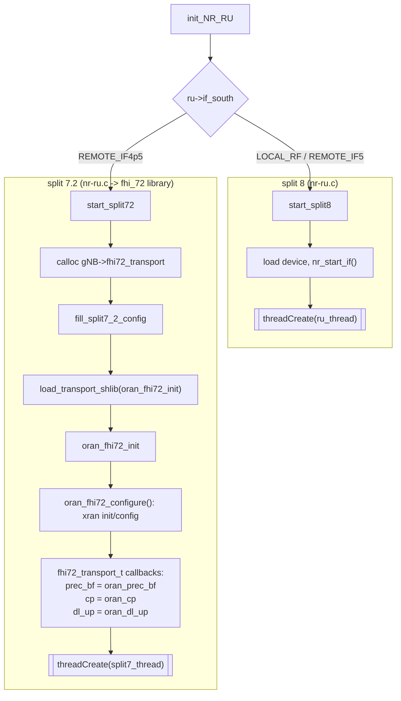
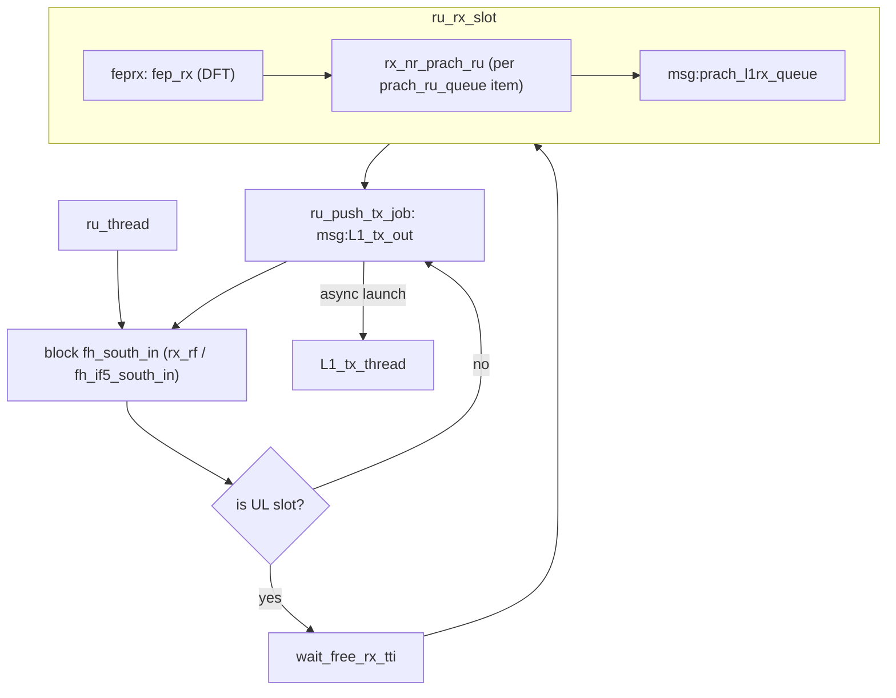
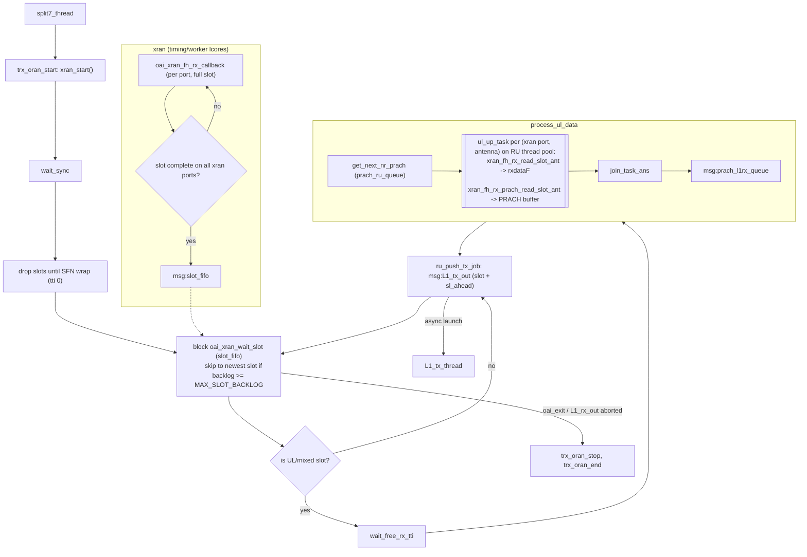
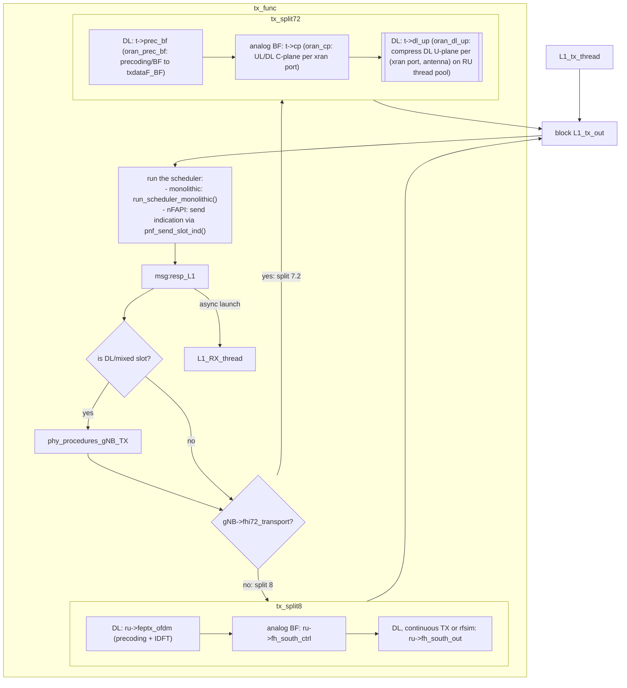
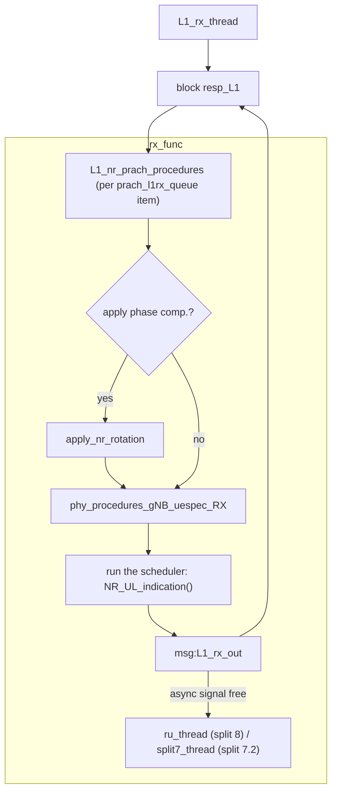

<!-- SPDX-License-Identifier: CC-BY-4.0 -->

This document is a high-level overview over the L1 threading mechanism.

The slot pace is given by a fronthaul thread, which depends on the split:

- split 8 / IF5 (local RF, rfsimulator, eCPRI IF5): `ru_thread()` in
  `executables/nr-ru.c`, driven by time-domain RX samples;
- split 7.2 (`REMOTE_IF4p5`, O-RAN fronthaul through xran): `split7_thread()`
  in the `fhi_72` library (`radio/fhi_72/oran_isolate.c`), driven by xran slot
  callbacks.

Both feed the same L1 TX/RX pipeline (`L1_tx_thread()`, `L1_rx_thread()`) and
use the same queues (`L1_tx_out`, `resp_L1`, `L1_rx_out`, `prach_ru_queue`,
`prach_l1rx_queue`).

## Fronthaul setup

The split 7.2 interface is defined in `radio/COMMON/gnb_fhi72_if.h`:

- `split7_config_t` holds the cell/RU parameters needed by xran (bandwidth,
  frequencies, numerology, slot directions, TDD pattern, PRACH, `sl_ahead`),
  pointers to the RU frequency-domain buffers (`rxdataF`, `txdataF_BF`) and the
  RU thread pool used for per-antenna U-plane (de)compression. It is filled by
  `fill_split7_2_config()`.
- `fhi72_transport_t` holds `split7_config_t`, the handle of `split7_thread()`
  and the TX callbacks `prec_bf()`, `cp()` and `dl_up()` called from
  `tx_func()`. `PHY_VARS_gNB` only holds a pointer to it
  (`gNB->fhi72_transport`, `NULL` for split 8).
- `oran_fhi72_init()` is the library entry point (`fhi72_init_t`), loaded with
  `load_transport_shlib()`.

## Fronthaul thread, split 8: `ru_thread()`

The main thread is `ru_thread()`. It blocks on reception of radio samples
(time domain). In the case of an UL slot, it waits that no more than N UL
jobs are scheduled (via `wait_free_rx_tti()`, which waits on queue
`L1_rx_out`, cf. the RX L1 processing further below). Then, in
`ru_rx_slot()`, it performs RX front-end processing (RX FEP -> `fep_rx()`,
i.e. DFT) to reach a frequency domain representation of the RX signal, and
extracts PRACH (`rx_nr_prach_ru()`) for each PRACH occasion of this slot taken
from `prach_ru_queue`, handing it to L1 through `prach_l1rx_queue`.

Afterwards, it triggers TX processing by pushing a message into the FIFO queue
`L1_tx_out` (`ru_push_tx_job()`), which asynchronously starts a TX job in
`L1_tx_thread()` (see below). After that, it blocks again on reception on the
radio.

## Fronthaul thread, split 7.2: `split7_thread()`

In split 7.2, there is no `ru_thread()`. xran receives the U-plane in its own
lcores and calls `oai_xran_fh_rx_callback()` per xran port once the UL
deadline of a slot passed. `slot_ready()` pushes the slot into `slot_fifo` once
all xran ports completed it (ports may have different UL deadlines).

`split7_thread()` starts xran, waits for the SFN wrap (xran accepts the
U-plane and sends the C-plane only from frame 0, slot 0 on), then loops:

- block on `oai_xran_wait_slot()`; if it falls behind by
  `MAX_SLOT_BACKLOG` slots or more, it skips to the newest slot;
- in an UL (or mixed) slot, wait for a free `rxdataF` slot with
  `wait_free_rx_tti()` (same as `ru_thread()`), then `process_ul_data()`
  reads PUSCH and PRACH from the xran buffers with one task per (xran port,
  antenna) on the RU thread pool, decompressing the IQ into the
  `RU_RX_SLOT_DEPTH` slot position of `rxdataF` used by L1, and hands PRACH to
  L1 through `prach_l1rx_queue`. No DFT is needed, as 7.2 is a
  frequency-domain interface;
- push the TX job for slot + `sl_ahead` into `L1_tx_out` (`ru_push_tx_job()`,
  without timestamp).

On exit, it stops xran. It is joined in `term_gNB_Tpool()` after `L1_rx_out`
is aborted, as it may block in `wait_free_rx_tti()`.

## L1 TX: `L1_tx_thread()`

The `L1_tx_thread()` processes individual TX jobs sequentially, by waiting for
new messages on queue `L1_tx_out`, signalling individual TX jobs. For each
message, it calls `tx_func()` which does in order:

- run the scheduler through `NR_slot_indication`, which corresponds to a
  "Slot.indication" in FAPI parlance. This runs the scheduler, and schedules a
  given slot (either downlink, uplink, or both).
- trigger RX processing by pushing a message into the FIFO queue `resp_L1`,
  asynchronously starting an RX job in `L1_rx_thread()` (see below).
- process the current L1 TX job through `phy_procedures_gNB_TX()` in DL or
  mixed slots
- hand the slot to the fronthaul, chosen once by `gNB->fhi72_transport`:
  - split 8, `tx_split8()`: precoding and IDFT (`feptx_ofdm()`), beam control
    (`fh_south_ctrl()`) and write to the radio board (`fh_south_out()`), the
    latter also in UL slots with continuous TX or rfsimulator;
  - split 7.2, `tx_split72()`: precoding/beamforming into `txdataF_BF`
    (`prec_bf()`), C-plane for analog beamforming (`cp()`, both UL and DL
    sections as per the slot direction) and DL U-plane (`dl_up()`, only in
    DL/mixed slots). xran sends the packets on air time; there is no
    timestamp.

After these steps, `tx_func()` return to `L1_tx_thread()`, which will wait for
the next TX job.

## L1 RX: `L1_rx_thread()`

The `L1_rx_thread()` processes individual RX jobs sequentially. It waits for a
new RX job through the queue `resp_L1`, and then calls `rx_func()`, which does
in order:

- run PRACH processing via `L1_nr_prach_procedures()` for each PRACH occasion
  in `prach_l1rx_queue`, filled by `ru_rx_slot()` (split 8) or
  `process_ul_data()` (split 7.2)
- optionally apply rotation to the RX signal if phase compensation is to be
  applied
- run the current L1 RX job through (`phy_procedures_gNB_uespec_RX()`), which
  notably includes PUCCH, PUSCH, SRS processing
- call the scheduler through `NR_ul_indication()`, which corresponds to FAPI
  uplink messages (e.g., `RX_data.indication`, `CRC.indication`,
  `UCI.indication` etc.)
- signal completion via FIFO queue `L1_rx_out()`, which tells the fronthaul
  thread (`ru_thread()` or `split7_thread()`) that RX processing finished and
  the `rxdataF` slot can be overwritten.

The signalling of scheduler data is done through a variable `UL_INFO`, which is
filled by `L1_nr_prach_procedures()` (for PRACH) and `phy_procedures_gNB_uespec_RX()`
(for PUCCH, PUSCH, SRS).

After these steps, `rx_func()` returns to `L1_rx_thread()`, which will wait the
next RX job.

Note that while individual TX (RX) jobs are run sequentially through
`L1_tx_thread()` (`L1_rx_thread()`), both TX and RX processing run in
parallel.
