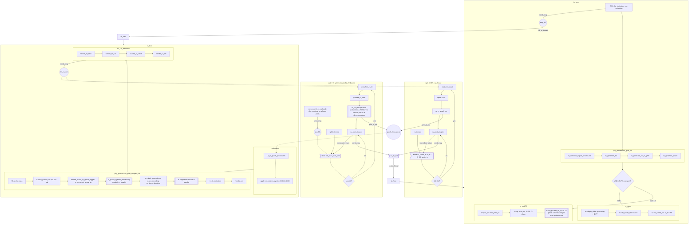
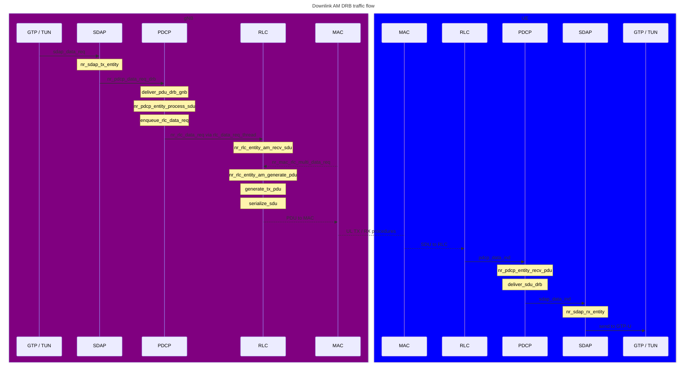
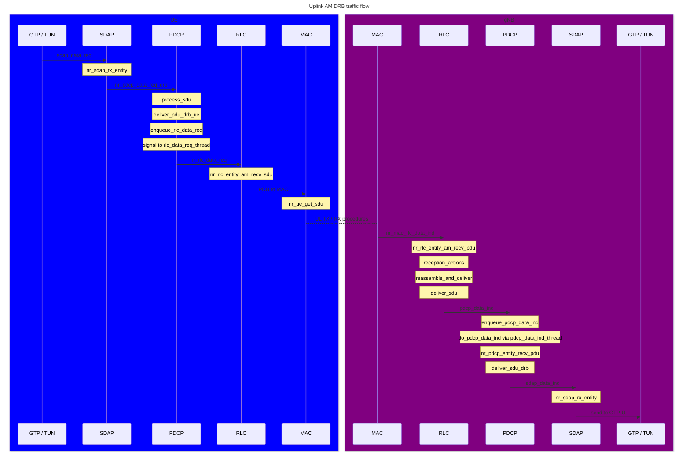

<!-- SPDX-License-Identifier: CC-BY-4.0 -->

The slot pace is given by the fronthaul thread: `ru_thread()` for split 8 /
IF5 (time domain), `split7_thread()` in the `fhi_72` library for split 7.2
(frequency domain, through xran). Both feed the same L1 TX/RX pipeline. See
[SW-archi-graph.md](./SW-archi-graph.md) for a per-thread description.

## Fronthaul threads

All SDR processing is triggered by the fronthaul. Frame and slot numbers are
derived from the received data; TX is processed `sl_ahead` slots ahead of RX.

### Split 8 / IF5: ru_thread()

`ru_thread()` (`executables/nr-ru.c`) loops on:

- `fh_south_in()` (`rx_rf()` for a local RF board, `fh_if5_south_in()` for
  IF5): block until the time-domain samples of one slot are available in
  `rxdata`. The RF board timestamp of the samples gives the frame and slot
  numbers; TX samples are written with a timestamp in the future.
- in UL slots, `wait_free_rx_tti()` then `ru_rx_slot()`: `feprx()` (DFT into
  `rxdataF`, in the `RU_RX_SLOT_DEPTH` ring) and `rx_nr_prach_ru()` for the
  PRACH occasions of this slot, handed to L1 through `prach_l1rx_queue`.
- `ru_push_tx_job()`: push the TX job to `L1_tx_out`.

### Split 7.2: split7_thread()

`split7_thread()` (`radio/fhi_72/oran_isolate.c`) is started by
`oran_fhi72_init()` and paced by xran: `oai_xran_wait_slot()` returns a slot
once its UL deadline passed on all xran ports. In UL slots, it waits with
`wait_free_rx_tti()` and reads PUSCH (into `rxdataF`) and PRACH from the xran
buffers in `process_ul_data()`; then it pushes the TX job with
`ru_push_tx_job()`. There is no time-domain processing nor timestamp.

## L1 TX: tx_func()

Run by `L1_tx_thread()` for each `L1_tx_out` message.

### NR_slot_indication()
Runs the MAC scheduler for the TX slot: `run_scheduler_monolithic()` calls
`gNB_dlsch_ulsch_scheduler()`, see [Scheduler](#scheduler); with nFAPI,
`pnf_send_slot_ind()` sends a Slot.indication to the VNF instead. The result
(`NR_Sched_Rsp_t`) holds the FAPI DL_TTI, TX_data, UL_TTI and UL_DCI requests.
UL_TTI is saved by `nr_save_ul_tti_req()` (PRACH, PUCCH, PUSCH and SRS jobs
queued for the RX slot), then the RX job is pushed to `resp_L1`.

### phy_procedures_gNB_TX()
In DL and mixed slots, generates the slot in `txdataF` (frequency domain):

* `nr_common_signal_procedures()`: SSB (PSS, SSS, PBCH)
* `nr_generate_dci()`: PDCCH, the scheduling information for each UE in both
  DL and UL
* `nr_generate_csi_rs_gNB()`, `nr_generate_prs_gNB()`: CSI-RS, PRS
* `nr_generate_pdsch()`: DL shared channel (user data)

### Fronthaul TX
Selected by `gNB->fhi72_transport`:

* split 8, `tx_split8()`: `feptx_ofdm()` (`nr_feptx_tp()`: precoding, then
  per-antenna IDFT and cyclic prefix in `nr_feptx0()`, on the RU thread pool),
  `fh_south_ctrl()` for analog beams and `fh_south_out()` (`tx_rf()` or
  `fh_if5_south_out()`), writing the samples with their TX timestamp.
* split 7.2, `tx_split72()`: `prec_bf()` (precoding/beamforming into
  `txdataF_BF`), `cp()` (C-plane for analog beams) and `dl_up()` (DL U-plane
  compression per xran port and antenna). xran sends the packets at their air
  time.

## L1 RX: rx_func()

Run by `L1_rx_thread()` for each `resp_L1` message, in UL and mixed slots. The
results are collected in `UL_INFO`, local to `rx_func()`, and given to MAC at
the end of the same slot.

### L1_nr_prach_procedures()
PRACH detection (`rx_nr_prach()`) for each occasion taken from
`prach_l1rx_queue`; fills `UL_INFO.rach_ind`.

### phy_procedures_gNB_uespec_RX()
Takes the PUCCH, PUSCH and SRS jobs of this slot from their queues, then:

* `fill_ul_rb_mask()`: PRBs used in this slot, for noise/interference
  measurement
* `handle_pucch()`: PUCCH decoding from `rxdataF` (`nr_decode_pucch0()`,
  `nr_decode_pucch1()`, `nr_decode_pucch2()`), fills `UL_INFO.uci_ind`
* PUSCH jobs are grouped (MU-MIMO) and demodulated by
  `handle_pusch_rx_group_trigger()` -> `nr_rx_pusch_group_tp()`:
    * `nr_pusch_channel_estimation()`, `nr_chest_time_domain_avg()`,
      `nr_ptrs_run()`
    * per symbol on the thread pool (`nr_pusch_symbol_processing()`):
      `nr_ulsch_extract_rbs()`, `nr_channel_compensation()` / MMSE,
      `nr_compute_llr()`, unscrambling and UCI demultiplexing
* PUSCH without detected signal (DTX) is reported with a failed CRC by
  `nr_fill_indication()`
* `nr_ulsch_procedures()`: `nr_uci_decoding()` (UCI on PUSCH),
  `nr_ulsch_decoding()` (LDPC, all segments in parallel), then
  `nr_fill_indication()`, filling `UL_INFO.crc_ind` and `UL_INFO.rx_ind`
* `handle_srs()`: SRS channel estimation, fills `UL_INFO.srs_ind`

### NR_UL_indication()
Hands `UL_INFO` to MAC (`NR_IF_Module.c`):

* `handle_nr_rach()`: RACH detections, starts RA (Msg2 is scheduled later by
  `nr_schedule_RA()`)
* `handle_nr_uci()`: HARQ feedback, SR and CSI reports
* `handle_nr_ulsch()`: CRC and UL data, given to RLC by
  `nr_mac_rlc_data_ind()`
* `handle_nr_srs()`: SRS measurements

Finally, `rx_func()` releases the `rxdataF` slot to the fronthaul thread via
`L1_rx_out`.

## Scheduler

The main scheduler function `gNB_dlsch_ulsch_scheduler()` is called from
`NR_slot_indication()` (see above), once per slot. It holds the MAC scheduler
lock for the whole slot. The scheduler uses internal maps of used RBs,
`vrb_map` and `vrb_map_UL` (per beam), so each specific channel scheduler can
see the already allocated RBs in each slot (the vrb_map of the slot is cleared
when it starts).

`nr_mac_update_timers()` updates the per-UE timers. RLC and PDCP are not run by
the scheduler; RLC timers run in `nr_rlc_ms_tick()`, see [RLC](#rlc).

In order, it calls:

* `schedule_nr_mib()`, `schedule_nr_sib1()`, `schedule_nr_other_sib()`: MIB,
  SIB1 and other SIBs
* `schedule_nr_prach()`: schedules the (fixed) PRACH region in advance
* `schedule_nr_pcch()`: paging
* `nr_csirs_scheduling()`, `nr_schedule_periodic_srs()`,
  `nr_csi_meas_reporting()`, `nr_sr_reporting()`, `nr_measgap_scheduling()`:
  periodic CSI-RS, SRS, CSI reports in PUCCH, SR and measurement gaps
* `nr_schedule_RA()`: for each ongoing RA process, schedules Msg2 via
  `nr_generate_Msg2()` (and the Msg3 PUSCH), Msg4 and their retransmissions
* `nr_schedule_ulsch()`: UL scheduling, see below
* `nr_schedule_ue_spec()`: DL scheduling, see below
* `nr_schedule_pucch()`: fills the PUCCH FAPI PDUs for this slot

`nr_schedule_ulsch()` and `nr_schedule_ue_spec()` are divided into a
"preprocessor" and a "postprocessor": the first makes the scheduling
decisions, the second fills the FAPI structures (DCI, PDSCH/PUSCH PDUs,
TX_data) to indicate to the PHY what it is supposed to do. The preprocessor is
exchangeable (`pre_processor_dl`/`pre_processor_ul`): `nr_preprocessor_phytest()`
and `nr_ul_preprocessor_phytest()` schedule one user for phytest,
`nr_dlsch_preprocessor()` and `nr_ulsch_preprocessor()` multiple users through
a pipeline of exchangeable policies, see
[scheduler architecture](./MAC/scheduler-architecture.md):

1. collect candidate UEs (retransmissions and UEs with data or SR/BSR; for DL,
   buffer status via `nr_mac_rlc_status_ind()`)
2. RI/PMI (DL) or RI/TPMI (UL) selection
3. beam selection (multiple beams only)
4. time-domain allocation selection
5. MCS selection from the BLER state
6. RB allocation policy per beam (proportional fair by default), which
   validates CCE (`find_pdcch_candidate()`) and, for DL, PUCCH for HARQ
   feedback (`nr_acknack_scheduling()`) before committing an allocation in
   the vrb_map
7. TBS computation and postprocessing of the scheduled UEs; the DL data is
   pulled from RLC with `nr_mac_rlc_multi_data_req()`

## RRC
RRC is a regular ITTI task with a loop on queue `TASK_RRC_GNB`. It receives
NGAP, F1AP, E1AP and XnAP messages and timers; it is not triggered per slot.

The RRC communicates with the MAC scheduler through F1AP messages (F1 setup,
UE context setup/modification/release, DL/UL RRC message transfer), even in
monolithic mode, where they are direct function calls instead of SCTP.

## RLC
RLC code is new implementation, not using OAI mechanisms: it is implemented
directly on pthreads, ignoring OAI common functions. It is a library, called
from the MAC scheduler, PDCP and the F1 interface threads, protected by a
mutex.

RLC data is isolated and encapsulated.
It is stored under a global var: `nr_rlc_ue_manager`, created by
`nr_rlc_module_init()`. RLC entities are per UE and do not share data between
UEs.

When adding a UE, external code has to call `nr_rlc_add_srb()` and/or
`nr_rlc_add_drb()`, to remove it: `nr_rlc_remove_ue()`. Entities are
reconfigured with `nr_rlc_reconfigure_entity()`, re-established with
`nr_rlc_reestablish_entity()` and released with `nr_rlc_release_entity()`.

`nr_rlc_ms_tick()` must be called every ms to manage the internal timers; the
softmodem registers it in the time manager (`time_manager_start()`).

`successful_delivery()` and `max_retx_reached()` are entity callbacks; the
latter triggers radio link failure through the handler set by
`nr_rlc_set_rlf_handler()`.

### RLC data flow

#### TX Flow

Incoming data to be transmitted is forwarded to RLC by PDCP via `nr_rlc_data_req()`.

At the transport layer, in downlink (DL) at the gNB and uplink (UL) at UE, the scheduler relies on knowing the quantity of data awaiting transmission, therefore is using the following MAC/RLC interface functions:

* `nr_mac_rlc_multi_data_req()` (gNB DLSCH) or `nr_mac_rlc_data_req()` to retrieve data bytes to be transmitted by RLC and to fill the MAC SDU
* `nr_mac_rlc_status_ind()` to request and set the number of bytes scheduled for transmission by the RLC

Subsequently, the scheduler issues commands to lower layers.

#### RX Flow

In the RX chain, in downlink (DL) at the UE and uplink (UL) at gNB, the transport layer pushes data into RLC through `nr_mac_rlc_data_ind()`. Following this, RLC forwards the data to PDCP by invoking `pdcp_data_ind()` via a complex internal callback mechanism (`deliver_sdu()`).

## PDCP

The PDCP implementation is secured by a general mutex, akin to the design of the RLC layer. This setup ensures that PDCP data remains isolated and encapsulated.

The PDCP layer is initialized by `nr_pdcp_layer_init()`.

To manage UE connections, `nr_pdcp_add_srbs()` is employed for adding UE SRBs in PDCP, while `nr_pdcp_remove_UE()` is used for their removal. Similarly, `nr_pdcp_add_drb()` adds UE DRB in PDCP, with `nr_pdcp_remove_UE()` handling their removal.

### PDCP Tx flow

On the Tx side (downlink in gNB), the entry functions `nr_pdcp_data_req_drb()` and `nr_pdcp_data_req_srb()` are called by the upper layer. The upper layer could be SDAP (from GTP, or from the `gnb_tun_read_thread` thread, `sdap_tun_read_thread()`, which reads directly from a TUN interface if the 3GPP core is not used). The PDCP internals for `nr_pdcp_data_req_srb()` and `nr_pdcp_data_req_drb()` are thread-safe. Within these functions, the PDCP manager protects access to the SDU processing function of PDCP (`process_sdu()` callback, corresponding to `nr_pdcp_entity_process_sdu()`) using mutex. The resulting PDU is queued (`enqueue_rlc_data_req()`) and pushed to RLC by `rlc_data_req_thread()` calling `nr_rlc_data_req()`.

### PDCP Rx flow

At the Rx side, `pdcp_data_ind()` serves as the entry point for receiving data from RLC. Within `pdcp_data_ind()`, the PDCP manager mutex protects access to the PDU receiving function of PDCP (`recv_pdu()` callback corresponding to `nr_pdcp_entity_recv_pdu()` for DRBs). Following this, the `deliver_sdu_drb()` function dispatches the received data to the SDAP sublayer.

### PDCP security

nr_pdcp_config_set_security(): sets the keys for AS security of a UE

## AM DRB traffic flow in OAI

A sequence diagram of the traffic flow across PDCP and RLC layers. By default, data traffic is directed towards AM DRBs.

This is the flow for downlink, involving MAC and upper layers:

and for uplink:

## GTP
GTP-U is implemented in `openair3/ocp-gtpu`. It is mostly a library called
directly from other threads; its state (`globGtp`) is protected by a mutex.

### Initialization

`gtpv1Init()` creates a GTP-U instance: a UDP socket on a given local address,
and a receiver thread `gtpv1uReceiver()` for it. The gNB/CU-UP creates one
instance for N3 (NG-U, towards the core) and one for F1-U (between CU-UP and
DU).

The ITTI task `TASK_GTPV1_U` (`gtpv1uTask()`) only handles a few legacy
messages (e.g., `GTPV1U_REQ` to create an instance, end markers).

### Tunnels

`newGtpuCreateTunnel()` is the generic tunnel creation function; it is wrapped
by `gtpv1u_create_ngu_tunnel()` (NR), and `gtpv1u_create_s1u_tunnel()`/
`gtpv1u_create_x2u_tunnel()` (LTE, NSA). The parameters are:

1. outgoing TEID and remote address, associated with the outgoing pair
   (ue_id, bearer id)
2. incoming pair (ue_id, bearer id) and callbacks for incoming data: a
   generic one and, for N3, an SDAP one (with QFI)

It returns the incoming TEID. E.g., in the CU-UP (`cucp_cuup_handler.c`), the
N3 tunnel delivers DL data to `sdap_data_req()` (or `nr_pdcp_data_req_drb()`),
and the F1-U tunnel delivers UL data to `cu_f1u_data_req()`; in the DU, the
F1-U tunnel delivers DL data to RLC (`DURecvCb()`).

### Outgoing packets

`gtpv1uSendDirect()` and variants (`gtpv1uSendDirectWithQFI()` from SDAP on N3,
`gtpv1uSendDirectWithNRUSeqNum()` from PDCP on F1-U) look up the TEID of the
pair (ue_id, bearer id), encode the GTP-U header and send the packet from the
calling thread.

### Incoming packets

`gtpv1uReceiver()` reads the socket, looks up the incoming TEID and calls the
associated callback with its pair (ue_id, bearer id), in the receiver thread
context.

## NGAP
NGAP is an ITTI task (`TASK_NGAP`, `ngap_gNB_task()`), with SCTP handled by
the SCTP task. NGAP messages are mostly exchanged with the RRC task.
