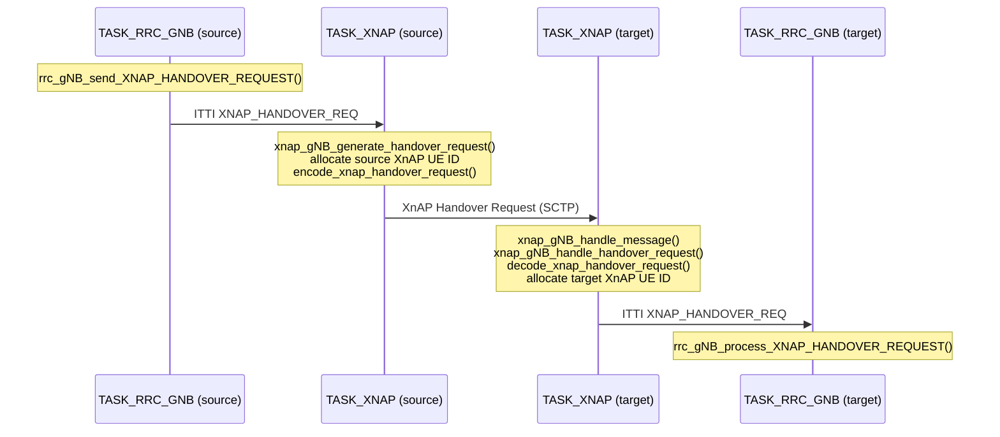

<!-- SPDX-License-Identifier: CC-BY-4.0 -->

# Xn design

[[_TOC_]]

## 1. Introduction

Xn is the interface between two NG-RAN nodes (gNBs). Its control plane (Xn-C)
carries the Xn Application Protocol (XnAP) over SCTP. Its user plane (Xn-U)
carries data forwarding over GTP-U.

Xn specs:

* 3GPP TS 38.420 Xn general aspects and principles
* 3GPP TS 38.421 Xn layer 1
* 3GPP TS 38.422 Xn signalling transport
* 3GPP TS 38.423 Xn Application Protocol (XnAP)
* 3GPP TS 38.424 Xn data transport
* 3GPP TS 38.425 Xn user plane protocol

OAI implements XnAP according to TS 38.423 v16.2.0 (ASN.1 grammar
`openair2/XNAP/MESSAGES/ASN1/xnap_R16.2.0`). Xn-C uses SCTP port `38422`
and payload protocol identifier `61` (`xnap_default_values.h`).

The main use of Xn in OAI is the **Xn handover**: a handover between two
gNBs (or CU-CPs) that is prepared directly between the gNBs, without the AMF.
Only the path switch at the end of the handover involves the AMF (NGAP Path
Switch Request). See the [handover tutorial](../handover-tutorial.md#xn-handover)
to run it, and the [RRC developer documentation](../RRC/rrc-dev.md#inter-gnb-handover-xn)
for the RRC handover flow.

## 2. OAI implementation status

Supported:

* Monolithic gNB and CU (CU-CP in an E1 split): the XnAP task runs where RRC runs.
* One Xn-C association per peer gNB, up to 8 configured candidates
  (`XNAP_MAX_NB_CANDIDATES`); incoming associations are not limited.
* Xn Setup (Interface Management)
* Xn handover preparation and execution (Mobility Management):
  * Handover Request / Handover Request Acknowledge / Handover Preparation Failure
  * SN Status Transfer
  * UE Context Release
  * Handover Cancel, when the UE re-establishes in the source cell during the
    handover, the HandoverCommand cannot be decoded or the source removes the
    UE; at the target also when the Xn association to the source is lost
* Handover trigger by A3 measurement event or telnet

Not supported:

* Xn-U (no data forwarding during handover)
* Xn Removal, NG-RAN node Configuration Update, Reset, Error Indication, RAN
  Paging, Retrieve UE Context, dual connectivity procedures. The
  [XnAP library](./XnAP-lib.md) can encode/decode Handover Success and RAN
  Paging, but the gNB does not use them yet.
* XnAP timers TXnRELOCprep and TXnRELOCoverall: the source waits without
  limit for the Handover Request Acknowledge and the UE Context Release.
* NGAP Path Switch Request Failure.
* Xn on a DU (Xn is terminated in the CU-CP).
* IPv6 Xn-C addresses.

## 3. Code structure

| Directory / file                                  | Content                                                                 |
|---------------------------------------------------|-------------------------------------------------------------------------|
| `openair2/XNAP/xnap_gNB.c`                        | `xnap_task()`: ITTI loop, SCTP association handling, messages from RRC |
| `openair2/XNAP/xnap_gNB_handlers.c`               | Decoding of incoming PDUs and callback table per procedure code         |
| `openair2/XNAP/xnap_common.c`                     | Xn instances and peers (RB tree keyed by SCTP association ID)           |
| `openair2/XNAP/xnap_ids.c`                        | XnAP UE ID allocation and mapping to RRC UE IDs                         |
| `openair2/XNAP/xnap_gNB_encoder.c`                | APER encoding of an XnAP PDU                                            |
| `openair2/XNAP/xnap_gNB_itti_messaging.c`         | Send data / close association towards `TASK_SCTP`                       |
| `openair2/XNAP/lib/`                              | Message encoders/decoders, see [XnAP library](./XnAP-lib.md)            |
| `openair2/XNAP/tests/`                            | Library unit test and `xn-simulator-test`                               |
| `openair2/COMMON/xnap_messages_def.h`, `_types.h` | ITTI messages between XnAP and RRC                                      |
| `openair2/RRC/NR/rrc_gNB_XNAP.c`                  | RRC side: build messages to XnAP, process messages from XnAP            |
| `openair2/RRC/NR/rrc_gNB_mobility.c`              | Xn handover trigger and handover callbacks, Xn candidate list           |
| `openair2/GNB_APP/gnb_config_xn.c`                | `Xn_INTERFACE` configuration                                            |

### 3.1 Tasks and message flow

XnAP runs in its own ITTI task, `TASK_XNAP`, created by `gNB_app_task()` if
`Xn_INTERFACE.gnb_ipv4_address_for_xnc` is configured. RRC and XnAP exchange
ITTI messages. RRC also calls `xnap_ids.c` directly, which is thread-safe: the
target RRC binds the UE it creates (`xn_bind_target_ue()`), and RRC looks up
and removes the XnAP UE IDs of a handover it ends itself (Handover Preparation
Failure, Handover Cancel, removal of the UE), as the UE may be removed before
XnAP sends the message. XnAP owns everything specific
to the Xn interface (SCTP associations, ASN.1, XnAP UE IDs), while RRC only
refers to a handover by its RRC UE ID.

Outgoing messages: RRC sends an ITTI message (e.g. `XNAP_HANDOVER_REQ`) to
`TASK_XNAP`. `xnap_task()` looks up the peer and the XnAP UE IDs (RRC already
resolved them for the Handover Preparation Failure and the Handover Cancel),
encodes the PDU with the library and sends it to `TASK_SCTP`.

Incoming messages: `TASK_SCTP` delivers `SCTP_DATA_IND`.
`xnap_gNB_handle_message()` decodes the PDU and calls the handler from the
callback table `xnap_messages_callback[procedureCode][direction]`. The
handler decodes the message with the library, maps the XnAP UE IDs to the
RRC UE ID and forwards an ITTI message to `TASK_RRC_GNB`.



ITTI messages between RRC and XnAP:

| ITTI message                 | Direction            | Purpose                                              |
|------------------------------|----------------------|------------------------------------------------------|
| `XNAP_REGISTER_GNB_REQ`      | GNB_APP -> XNAP      | Create Xn instance, listen, connect to candidates    |
| `XNAP_SETUP_IND`             | XNAP -> RRC          | Xn Setup with a peer completed: add Xn candidate     |
| `XNAP_PEER_SHUTDOWN_IND`     | XNAP -> RRC          | Peer association lost: remove Xn candidate           |
| `XNAP_HANDOVER_REQ`          | RRC <-> XNAP         | Handover Request                                     |
| `XNAP_HANDOVER_REQ_ACK`      | RRC <-> XNAP         | Handover Request Acknowledge                         |
| `XNAP_HANDOVER_PREP_FAILURE` | RRC <-> XNAP         | Handover Preparation Failure                         |
| `XNAP_SN_STATUS_TRANSFER`    | RRC <-> XNAP         | SN Status Transfer                                   |
| `XNAP_UE_CONTEXT_RELEASE`    | RRC <-> XNAP         | UE Context Release                                   |
| `XNAP_HANDOVER_CANCEL`       | RRC <-> XNAP         | Handover Cancel; also to abort an incoming handover when the source peer is lost |

### 3.2 Peers and Xn candidates

On `XNAP_REGISTER_GNB_REQ` (sent by GNB_APP after NG Setup, so the gNB ID,
PLMN and TAIs are known), XnAP:

1. Opens an SCTP listener on `gnb_ipv4_address_for_xnc`.
2. Sends an SCTP association request to each address in
   `candidate_gnb_ipv4_address_for_xnc`.

A peer (`xnap_peer_t`) is created when an SCTP association comes up, in
either direction, and is keyed by its SCTP association ID. The peer is
`WAITING` until Xn Setup completes, then `CONNECTED`. The gNB that opened the
association sends the Xn Setup Request. If both gNBs connect to each other at
the same time, the redundant association is closed when its Xn Setup
Request or Response is received, keeping the one already `CONNECTED`.

When Xn Setup completes, RRC receives `XNAP_SETUP_IND` and adds the remote
gNB ID to its list of Xn candidates (`rrc_add_xn_candidate()`). When a handover
is triggered towards a neighbour cell, RRC uses an Xn handover if the
neighbour's `gNB_ID` (from `neighbour_list`) is an Xn candidate, and an N2
handover otherwise.

### 3.3 XnAP UE IDs

Each XnAP UE-associated message carries the Source and Target NG-RAN node
UE XnAP IDs. They are allocated and stored only in XnAP (`xnap_ids.c`). Each
entry (`xn_ue_data_t`) holds the RRC UE ID, both XnAP UE IDs and the SCTP
association to the peer:

* Source gNB: `xn_add_source_ue()` allocates the source ID when sending the
  Handover Request; the target ID is stored on reception of the Handover
  Request Acknowledge.
* Target gNB: `xn_add_target_ue()` allocates the target ID when receiving the
  Handover Request; RRC binds it to the UE it creates with
  `xn_bind_target_ue()`.

The entry is removed when the handover ends (UE Context Release, Handover
Preparation Failure, Handover Cancel or loss of the peer association), when
the Handover Request or Acknowledge cannot be sent (encoding failure, peer
not connected), when the same RRC UE
starts a new Xn handover ("dropping stale Xn handover"), or when RRC removes
the UE (`xn_remove_ue()` in `rrc_remove_ue()`), so that a late XnAP message
does not reach a new UE reusing the RRC UE ID. At the target, Handover Cancel
carries only the source XnAP UE ID: the entry is found by the peer association
and the source ID (`xn_remove_target_ue_by_source_id()`).

The tables are global to the process, not per Xn instance. XnAP UE IDs are
allocated incrementally from 1 on each side.

## 4. Configuration

Xn is enabled by adding an `Xn_INTERFACE` section to the gNB configuration
(under `gNBs.[0]`):

```
Xn_INTERFACE :
{
  gnb_ipv4_address_for_xnc           = "127.0.0.10";
  candidate_gnb_ipv4_address_for_xnc = ({ ip = "127.0.0.20"; }, { ip = "127.0.0.30"; });
};
```

* `gnb_ipv4_address_for_xnc`: local Xn-C address. If it is absent, Xn is
  disabled and the XnAP task is not started.
* `candidate_gnb_ipv4_address_for_xnc`: Xn-C addresses of the peer gNBs this
  gNB connects to. It can be empty; this gNB then only accepts incoming
  connections.

Both gNBs must have the same PLMN; otherwise the Xn Setup Request is rejected
with an Xn Setup Failure. Each gNB needs a unique `gNB_ID`.

For an Xn handover, the source gNB also needs a `neighbour_list` entry for the
target cell, with the target's `gNB_ID`, `nr_cellid` and `physical_cellId`,
and, for the A3 trigger, a measurement configuration. This is the same
configuration as for N2 handover; see the
[neighbour configuration example](../handover-tutorial.md#example-neighbour-configuration).

## 5. Running Xn handover

See the [handover tutorial](../handover-tutorial.md#xn-handover) to run an Xn
handover with two rfsim gNBs and the OAI UE.

For tests without RAN or real UE, use the
[Xn simulator](../../openair2/XNAP/tests/xn-simulator/README.md). It runs
several gNB instances and a UE stub (NAS only) in one process, and hands the
UE over round-robin across all the gNBs, with the Path Switch to the AMF.
With `--xn-setup-only`, it only checks Xn Setup between all pairs.

## 6. Abnormal conditions

* Xn Setup fails (e.g. PLMN mismatch), the SCTP connection to a candidate
  fails, or an established association is lost: the connection is not
  retried. Restart one of the gNBs to try again.
* An XnAP message cannot be sent (encoding failure, or the peer is not
  connected): XnAP logs the error and drops the message. For a Handover
  Request, XnAP reports a Handover Preparation Failure to the source RRC, which
  ends the handover; the UE stays on the source. For a Handover Request
  Acknowledge, XnAP sends a Handover Preparation Failure to the source if the
  peer is connected, and `XNAP_HANDOVER_CANCEL` to the target RRC, which aborts
  the handover. The other messages are only dropped.
* The Xn association to a peer is lost: the peer is removed from the Xn
  candidates, and the handovers in progress with that peer are aborted. See
  [Loss of the Xn association](./xnap_procedures.md#loss-of-the-xn-association).
* The target cannot admit the UE: see
  [Handover Preparation Failure](./xnap_procedures.md#handover-preparation-failure).
