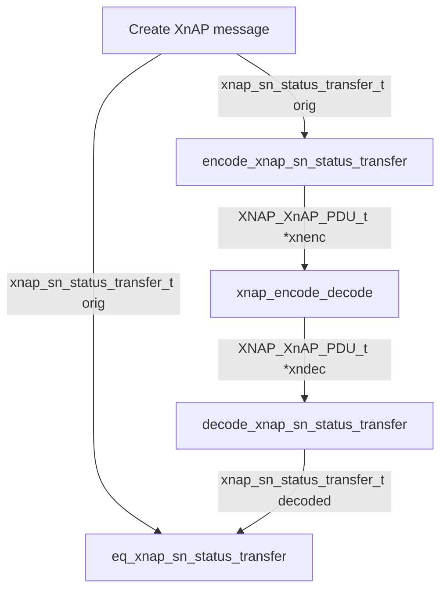

<!-- SPDX-License-Identifier: CC-BY-4.0 -->

# XnAP Messages Encoding & Decoding Library

[[_TOC_]]

## Intro

This library is for the encoding, decoding and testing of XnAP (Xn Application
Protocol) messages. It is built as the `xnap_lib` object library and has no
dependency on ITTI, SCTP or RRC.

## Implementation Details

The library includes the following components:

1. **Common Functions**:

The file [xnap_lib_common.c](../../openair2/XNAP/lib/xnap_lib_common.c) and its
header contain helpers shared by several messages, e.g. PLMN, S-NSSAI, cause,
NG-RAN CGI, GTP tunnel and TAI support encoding/decoding and equality checks.
[xnap_lib_includes.h](../../openair2/XNAP/lib/xnap_lib_includes.h) groups the
ASN.1 generated headers.

2. **Message-Specific Modules**:

Messages are grouped by XnAP procedure class:

* [xnap_gNB_interface_management.c](../../openair2/XNAP/lib/xnap_gNB_interface_management.c):
  Xn Setup Request, Xn Setup Response, Xn Setup Failure
* [xnap_gNB_mobility_management.c](../../openair2/XNAP/lib/xnap_gNB_mobility_management.c):
  Handover Request, Handover Request Acknowledge, Handover Preparation Failure,
  SN Status Transfer, UE Context Release, Handover Cancel, Handover Success,
  RAN Paging

Each message has the following functions, operating on the message structs of
[xnap_messages_types.h](../../openair2/COMMON/xnap_messages_types.h):

* **Encoder (encode_X)**: converts a message struct into an `XNAP_XnAP_PDU_t`,
  to be APER encoded with `xnap_gNB_encode_pdu()` and sent over Xn.
* **Decoder (decode_X)**: fills a message struct from a decoded
  `XNAP_XnAP_PDU_t`. Returns `false` if a mandatory IE is missing or invalid.
* **Equality Check (eq_X)**: compares two messages. It is useful for testing,
  to check that the decoded message matches the original one.
* **Memory Management (free_X)**: releases the memory allocated in a message.

e.g. for the SN Status Transfer:

```c
XNAP_XnAP_PDU_t *encode_xnap_sn_status_transfer(const xnap_sn_status_transfer_t *sn_status);
bool decode_xnap_sn_status_transfer(xnap_sn_status_transfer_t *out, const XNAP_XnAP_PDU_t *pdu);
bool eq_xnap_sn_status_transfer(const xnap_sn_status_transfer_t *a, const xnap_sn_status_transfer_t *b);
void free_xnap_sn_status_transfer(xnap_sn_status_transfer_t *msg);
```

Fields of the message structs that are not XnAP IEs, such as `rrc_ue_id`, are
used only for routing between RRC and XnAP. They are not encoded.

## Testing

The test [xnap_lib_test.c](../../openair2/XNAP/tests/xnap_lib_test.c) checks
the encoding and decoding of each message, in these steps:

* call the encoder function to convert the message into an XnAP PDU
* use `xnap_encode_decode` to perform the following steps:
  - Validate the encoded PDU against the ASN.1 constraints.
  - Encode the PDU using APER into a binary buffer.
  - Decode the binary buffer back into a PDU.
  - Return the decoded PDU.
* call the decoder function on the decoded XnAP PDU to obtain the decoded message
* call the equality function (e.g. `eq_xnap_sn_status_transfer`) to compare the
  original message with the decoded one
* free all messages and PDUs

Build and run it with ctest:

```bash
cd build
cmake .. -GNinja -DENABLE_TESTS=ON
ninja xnap_lib_test
ctest -R xnap_lib_test
```

A flowchart for a function testing XnAP messages, such as
`test_xn_sn_status_transfer`, would look like this:


