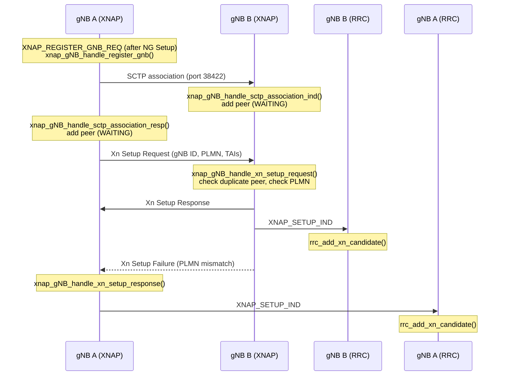
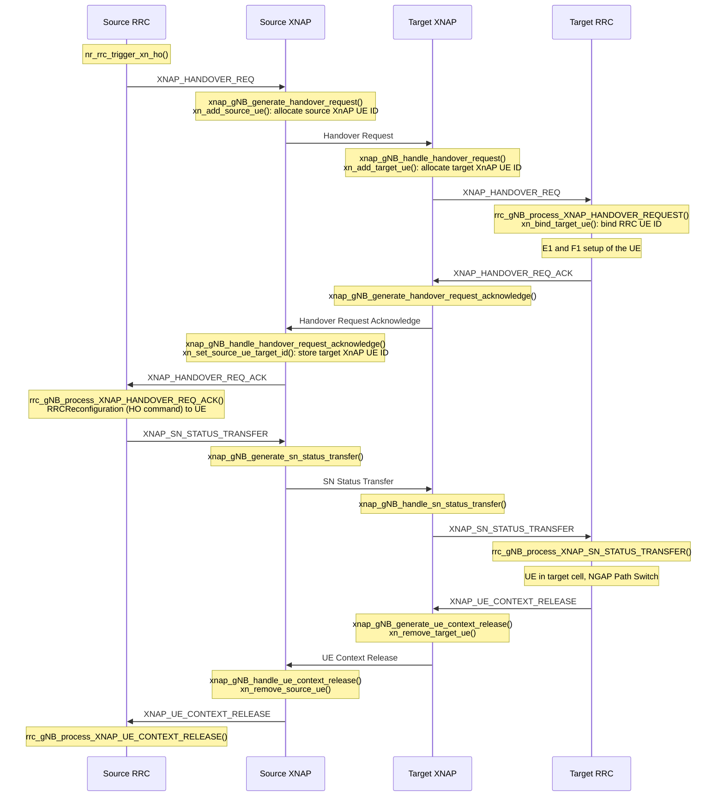
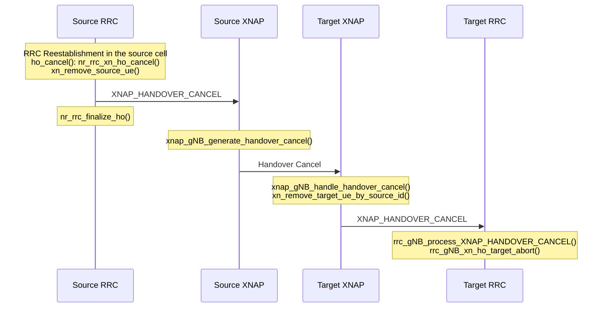

<!-- SPDX-License-Identifier: CC-BY-4.0 -->

# XnAP Procedures

[[_TOC_]]

## Introduction

The Xn interface connects two NG-RAN nodes. Its control plane is governed by
the Xn Application Protocol (XnAP), specified in:

* 3GPP TS 38.423 - Xn Application Protocol (XnAP)
* 3GPP TS 38.420 - Xn general aspects and principles
* 3GPP TS 38.422 - Xn signalling transport

XnAP procedures are grouped into:

* Interface Management procedures (non UE-associated), e.g. Xn Setup
* Mobility Management procedures (UE-associated), e.g. Handover Preparation,
  SN Status Transfer, UE Context Release, Handover Cancel
* Dual Connectivity procedures (not implemented in OAI)

For the code structure, see the [Xn design](./Xn-design.md) document. All
XnAP messages are sent on SCTP stream 0.

## Xn Setup

TS 38.423 §8.4.1. The two gNBs exchange application-level data so that the Xn-C
interface can operate. In OAI, the gNB that opens the SCTP association
sends the Xn Setup Request.

On Xn Setup Failure, the initiating gNB removes the peer. Xn Setup is not
retried. The responding gNB rejects the request with cause misc /
O&M-intervention if the MCC/MNC of the first PLMN differs from its own.

## Xn Handover

TS 38.300 §9.2.3.2 and TS 38.423 §8.2. The end-to-end flow, including the
F1, E1 and NGAP signalling and the RRC handover callbacks, is described in the
[RRC developer documentation](../RRC/rrc-dev.md#inter-gnb-handover-xn). The
figure below shows the XnAP part of a successful handover: the ITTI messages
between RRC and XNAP, and the XnAP UE ID handling in XNAP (`xnap_ids.c`).

### Handover Request

TS 38.423 §8.2.1. Source: `rrc_gNB_send_XNAP_HANDOVER_REQUEST()` fills
`xnap_handover_req_t` with:

* Target cell global ID, GUAMI, AMF UE NGAP ID and AMF address
* UE security capabilities and the AS security key KgNB* with its NCC
* UE AMBR and the established PDU sessions with their QoS flows
* the RRC container (HandoverPreparationInformation, which also carries the UE
  capabilities)
* UE History Information (last visited cell)

Target: `rrc_gNB_process_XNAP_HANDOVER_REQUEST()`:

1. Checks the target cell, its DU and a CU-UP. If one is missing, it sends a
   Handover Preparation Failure without creating a UE.
2. Creates the UE context and binds it to the XnAP UE IDs.
3. Takes the security key from the source directly as KgNB; unlike N2, no key
   is derived from NH. The target activates SRB1/SRB2 security.
4. Sets up the PDU sessions on the CU-UP (E1 Bearer Context Setup), then the
   UE on the target DU with the generic handover functions; see the
   [handover callbacks](../RRC/rrc-dev.md#handover).

### Handover Request Acknowledge

TS 38.423 §8.2.1.2. The target encodes the HandoverCommand and sends it in the
Target NG-RAN node To Source NG-RAN node Transparent Container, with the
admitted PDU sessions. The source XnAP stores the target XnAP UE ID and
forwards the message to RRC. RRC extracts the RRCReconfiguration from the
HandoverCommand (`doRRCReconfiguration_from_HandoverCommand()`) and sends it
to the UE on the source DU, stopping DL transmission.

### Handover Preparation Failure

TS 38.423 §8.2.1.3. The target sends it when it cannot admit the UE:

| Condition                                   | Cause                                           |
|---------------------------------------------|-------------------------------------------------|
| Target cell unknown                         | radioNetwork / cell-not-available               |
| No DU for the target cell                   | radioNetwork / no-radio-resources-available-in-target-cell |
| No CU-UP connected                          | misc / not-enough-user-plane-processing-resources |
| Ongoing RRC transaction, no admitted PDU session or HO command failed | radioNetwork / unspecified |

If the target already created a UE, `rrc_gNB_xn_ho_target_abort()` releases the
CU-UP bearers, the target DU context and the UE. At the source,
`rrc_gNB_process_XNAP_HANDOVER_PREP_FAILURE()` ends the handover context and
the UE stays on the source cell. The target RRC removes the target XnAP UE ID
before sending, as the UE may be removed before XNAP sends the message.

XNAP also ends the handover as for a Handover Preparation Failure when it
cannot send a message (encoding failure, peer not connected):

* Handover Request: the source XNAP reports `XNAP_HANDOVER_PREP_FAILURE` to
  the source RRC.
* Handover Request Acknowledge: the target XNAP sends a Handover Preparation
  Failure to the source if the peer is connected, and `XNAP_HANDOVER_CANCEL` to
  the target RRC, which aborts the handover with `rrc_gNB_xn_ho_target_abort()`.

### SN Status Transfer

TS 38.423 §8.2.2. When the source CU-UP reports the PDCP COUNT of the DRBs,
RRC calls the `ho_status_transfer` callback, which is
`rrc_gNB_send_XNAP_SN_STATUS_TRANSFER()` for Xn handover. The message carries,
per DRB, the UL and DL COUNT (PDCP SN and HFN) for 12- or 18-bit SN length.
The target forwards each DRB's COUNT to its CU-UP with
`e1_notify_pdcp_status()`.

### UE Context Release

TS 38.423 §8.2.7. The target sends it after the NGAP Path Switch Request
Acknowledge, to tell the source that the handover succeeded. Both XnAP instances remove the XnAP UE ID
mapping. The source RRC (`rrc_gNB_process_XNAP_UE_CONTEXT_RELEASE()`) releases:

* the CU-UP bearer context (E1 Bearer Context Release)
* the UE on the source DU (F1 UE Context Release Command, without
  RRCRelease to the UE); the UE context is freed on F1 UE Context Release
  Complete
* the NGAP UE context locally (`NGAP_UE_CONTEXT_LOCAL_RELEASE`), without
  signalling to the AMF, which now serves the UE through the target

If the source DU is offline, the UE is removed directly.

### Handover Cancel

TS 38.423 §8.2.3. The source cancels the handover when the UE re-establishes
in the source cell before the handover completes, or when the HandoverCommand
of the Handover Request Acknowledge cannot be decoded: RRC calls the
`ho_cancel` callback, which is `nr_rrc_xn_ho_cancel()` for Xn handover (cause
radioNetwork / failure-in-the-radio-interface-procedure), and ends the
handover context. RRC also cancels the handover when it removes the UE during
the handover (`rrc_remove_ue()`, cause radioNetwork / unspecified), e.g. on an
AMF UE Context Release. `rrc_gNB_send_XNAP_HANDOVER_CANCEL()` removes the
source XnAP UE ID, as RRC may remove the UE before XNAP sends the message, and
the source XnAP sends the message with the source XnAP UE ID and the cause.

The target XnAP removes the target XnAP UE ID of the handover, found by the
peer association and the source XnAP UE ID, and forwards the message to RRC.
`rrc_gNB_process_XNAP_HANDOVER_CANCEL()` releases the CU-UP bearers, the
target DU context and the UE with `rrc_gNB_xn_ho_target_abort()` if the UE did
not arrive yet. If RRC did not create the UE yet, it drops the handover when
binding the XnAP UE ID fails. A late Handover Request Acknowledge or Handover
Preparation Failure from the target is dropped at the source, as its XnAP UE
ID is unknown.

### Loss of the Xn association

If the SCTP association to a peer closes during a handover:

* At the source, each handover towards the peer without UE Context Release
  yet (also after the HO command was sent) ends as for a Handover Preparation
  Failure (cause transport / transport resource unavailable).
* At the target, each incoming handover from the peer is aborted with
  `rrc_gNB_process_XNAP_HANDOVER_CANCEL()` if the UE did not arrive yet. A UE
  that already completed the handover stays on the target.
