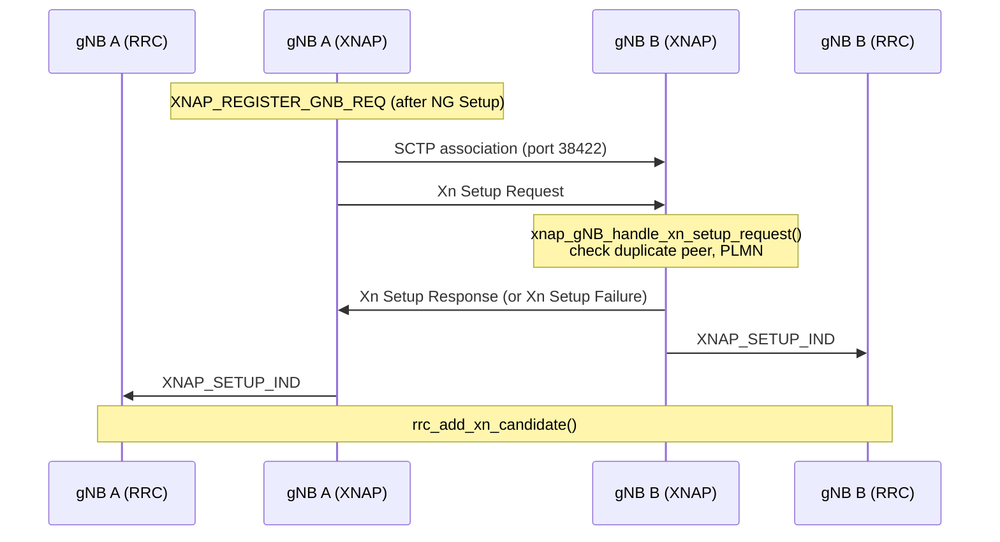
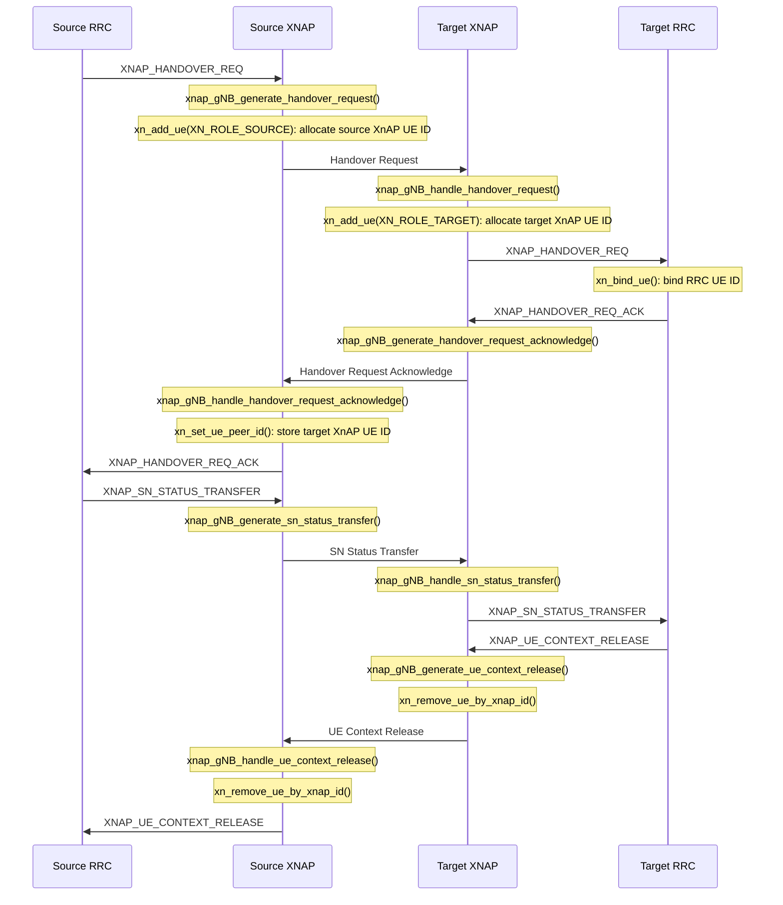

<!-- SPDX-License-Identifier: CC-BY-4.0 -->

# XnAP Procedures

[[_TOC_]]

## Introduction

The XnAP procedures implemented in OAI (TS 38.423). For the Xn interface, the
tasks and the XnAP UE IDs, see the [Xn design](./Xn-design.md). All XnAP
messages are sent on SCTP stream 0.

## Xn Setup

TS 38.423 §8.4.1. The gNB that opens the SCTP association sends the Xn Setup
Request (gNB ID, PLMN, TAIs). The peer answers with an Xn Setup Response, or
an Xn Setup Failure with cause misc / O&M-intervention if the MCC/MNC of its
first PLMN differs. On success, both RRCs add the peer to their Xn candidates;
on failure, the initiating gNB removes the peer. Xn Setup is not retried.

## Xn Handover

TS 38.300 §9.2.3.2 and TS 38.423 §8.2. The
[RRC developer documentation](../RRC/rrc-dev.md#inter-gnb-handover-xn) shows
the end-to-end flow. The figure below shows the XnAP part of a successful
handover: the ITTI messages between RRC and XNAP, and the XnAP UE IDs.

### Handover Request

TS 38.423 §8.2.1. `rrc_gNB_send_XNAP_HANDOVER_REQUEST()` sends the target
cell, GUAMI, AMF UE NGAP ID and address, UE security capabilities, KgNB* with
its NCC, UE-AMBR, the established PDU sessions with their QoS flows, the
HandoverPreparationInformation (with the UE capabilities) and the UE history.
`rrc_gNB_process_XNAP_HANDOVER_REQUEST()` at the target checks the cell, its
DU and a CU-UP, creates the UE and uses KgNB* directly as KgNB (unlike N2, no
key is derived from NH). It then sets up the bearers (E1) and the UE on the
target DU (F1) with the [handover callbacks](../RRC/rrc-dev.md#handover).

### Handover Request Acknowledge

TS 38.423 §8.2.1.2. The target sends the HandoverCommand with the admitted PDU
sessions. The source sends the RRCReconfiguration it contains to the UE on the
source DU.

### Handover Preparation Failure

TS 38.423 §8.2.1.3. The target cannot admit the UE:

* no target cell or DU: radioNetwork / cell-not-available
* no CU-UP: misc / not-enough-user-plane-processing-resources
* once the UE is created (ongoing RRC transaction, no admitted PDU session,
  HandoverCommand failure): radioNetwork / unspecified, and
  `rrc_gNB_xn_ho_target_abort()` releases the bearers, the target DU context
  and the UE

The source ends the handover and the UE stays on the source cell. XNAP also
ends a handover this way when it cannot send its Handover Request, or its
Handover Request Acknowledge (then also aborting the target UE).

### SN Status Transfer

TS 38.423 §8.2.2. The source sends the UL and DL PDCP COUNT of each DRB, from
its CU-UP (`ho_status_transfer` callback); the target forwards them to its
CU-UP with `e1_notify_pdcp_status()`.

### UE Context Release

TS 38.423 §8.2.7. The target sends it after the NGAP Path Switch Request
Acknowledge. The source releases the CU-UP bearers, the UE on the source DU
and the NGAP UE context locally, without signalling to the AMF.

### Handover Cancel

TS 38.423 §8.2.3. The source cancels the handover through the `ho_cancel`
callback (`nr_rrc_xn_ho_cancel()`):

* UE re-establishment in the source cell: radioNetwork /
  failure-in-the-radio-interface-procedure
* HandoverCommand that cannot be decoded: radioNetwork / unspecified
* UE removed during the handover (`rrc_remove_ue()`): radioNetwork /
  unspecified

The target finds the handover by the peer and the source XnAP UE ID, and
aborts it with `rrc_gNB_xn_ho_target_abort()` if the UE did not arrive yet. A
late Handover Request Acknowledge or Preparation Failure is then dropped at the
source.

### Loss of the Xn association

At the source, each handover towards the peer without UE Context Release yet
ends as for a Handover Preparation Failure (cause transport / transport
resource unavailable). At the target, each incoming handover from the peer is
aborted if the UE did not arrive yet.
