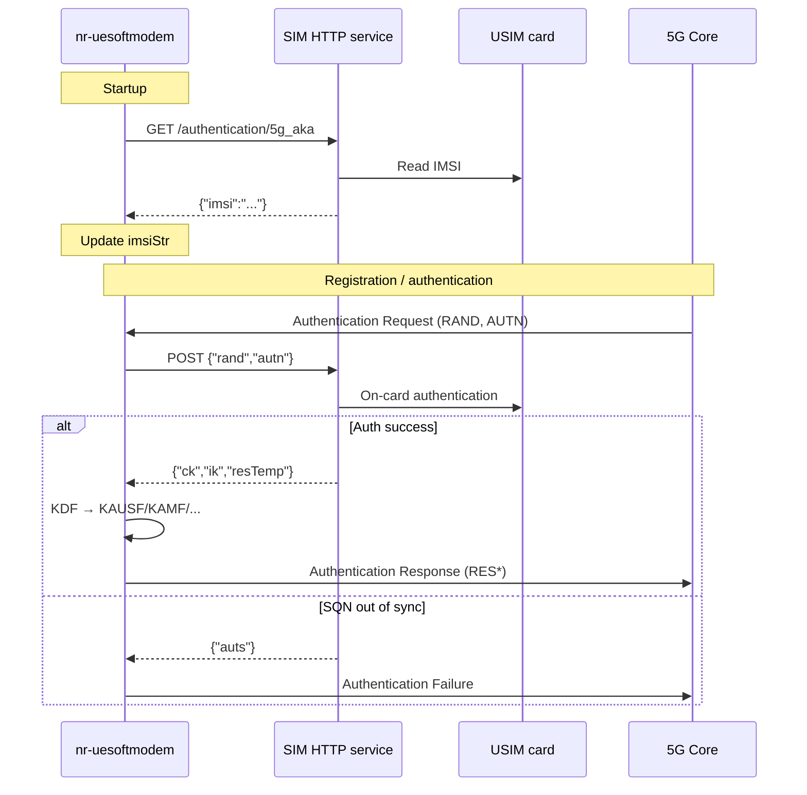

<!-- SPDX-License-Identifier: CC-BY-4.0 -->

# NR UE HTTP SIM Authentication — Implementation Guide

This document describes how the OAI NR UE (`nr-uesoftmodem`) uses an HTTP interface to connect to a **commercial SIM card reader** authentication service, enabling the UE to perform **5G AKA authentication and registration** on **operator networks (public network)** using a **real USIM card**.

[[_TOC_]]

## 1. Background and Objectives

### 1.1 Use Case: Connecting OAI UE to the Public Network

By default, the OAI NR UE reads **IMSI / Ki / OPc** from `ue.conf` and runs the Milenage algorithm locally. This suits **lab simulation** (OAI 5GC or a private core network).

To attach to the **public network (operator live network)** using a **commercial USIM** issued by an operator, the following constraints apply:

| Constraint | Description |
|------------|-------------|
| **Ki cannot be exported** | Ki on a commercial card is stored inside the USIM chip and cannot be read into `ue.conf` |
| **Authentication must run on the card** | Per 3GPP, RES/CK/IK are produced by the USIM `AUTHENTICATE` command, matching real UE behaviour |
| **OAI UE cannot read the card directly** | `nr-uesoftmodem` is a C program with no PC/SC smart card reader interface |

Therefore a **“card reader + HTTP bridge”** approach is required:

```
Commercial USIM ──► PC/SC reader ──► openxg-sim-auth ──HTTP──► OAI nr-uesoftmodem ──RF──► Operator gNB / core
```

The UE only obtains **IMSI** and **authentication vectors (RES/CK/IK)** over HTTP. **Ki always remains on the SIM**, allowing public-network authentication in a way that closely matches a commercial terminal.

### 1.2 Authentication Service

Card reading and on-card authentication are performed by the **`openxg-sim-auth`** executable (a standalone program, not OAI source). Download it from [bupt-openxg-lab/openxg-sim-auth](https://github.com/bupt-openxg-lab/openxg-sim-auth). It connects to the local PC/SC reader and serves HTTP; the OAI UE is only a client. Download and startup are in §4; API fields are in §3.

### 1.3 Design Goals

The HTTP service at `http://<host>:9090/authentication/5g_aka` provides:

| Phase | HTTP method | Function |
|-------|-------------|----------|
| UE startup | **GET** | Read **IMSI** from USIM and update local UICC configuration |
| Network authentication | **POST** | Send operator **RAND/AUTN** to USIM; obtain **RES/CK/IK** (or AUTS) |

**Ki always stays inside the USIM.** It is never sent over HTTP, consistent with commercial UICC security.

### 1.4 Comparison with Pure Simulation Mode

| Mode | Configuration | Ki source | Target network |
|------|---------------|-----------|----------------|
| Local simulation | `uicc_auth_mode = "local"` | `key` / `opc` in `ue.conf` | OAI 5GC, private core |
| Commercial SIM | `uicc_auth_mode = "http"` | Inside USIM (not visible) | **Operator public network** |

For public-network attach, `imsi` / `key` / `opc` in `ue.conf` are placeholders only. The real IMSI comes from GET (card read); authentication vectors come from POST (on-card computation).

---

## 2. Overall Architecture

```
┌──────────────────────┐                              ┌─────────────────────────────┐
│  Operator public net   │                              │  Local host (same or remote) │
│  gNB ─ AMF ─ UDM       │                              │                             │
└──────────┬─────────────┘                              │  ┌─────────┐   ┌──────────┐  │
           │ RF / NAS                                    │  │Commercial│   │ PC/SC    │  │
           │ Authentication Request (RAND,AUTN)        │  │ USIM    │◄──│ reader   │  │
           ▼                                            │  └────┬────┘   └──────────┘  │
┌─────────────────────┐         HTTP (JSON)          │       │ AUTHENTICATE          │
│   nr-uesoftmodem    │  ◄────────────────────────►  │  ┌────▼────────────────────┐  │
│   (OAI NR UE)       │   GET  → IMSI                │  │ openxg-sim-auth         │  │
│                     │   POST → RES/CK/IK or AUTS   │  │ HTTP auth service       │  │
│  uicc_auth_mode = "http"│                              │  │ :9090                   │  │
└─────────────────────┘                              │  └─────────────────────────┘  │
                                                       └─────────────────────────────┘
```

**Data flow summary:**

1. UE startup → HTTP GET → reader reads commercial card IMSI;
2. UE registers on public network → operator AMF sends RAND/AUTN → HTTP POST → on-card USIM auth → RES/CK/IK returned;
3. UE runs local KDF (KAUSF/KAMF, etc.) → Authentication Response → attach completes.

### 2.1 Data Responsibilities

| Data | Source | Notes |
|------|--------|-------|
| IMSI | HTTP GET (reader → commercial USIM) | Read at startup; overrides `ue.conf` placeholder |
| Ki / OPc | Commercial USIM | **Not readable; not sent over HTTP** |
| RAND / AUTN | Operator AMF (public NAS) | Parsed from Authentication Request |
| RES / CK / IK | HTTP POST (on-card AUTHENTICATE) | Computed by USIM chip, not local UE Milenage |
| KAUSF / KSEAF / KAMF | UE local KDF | Derived from CK/IK |

`key` / `opc` in `ue.conf` are used for local simulation when `uicc_auth_mode = "local"`. In public-network mode (`uicc_auth_mode = "http"`) they are placeholders; authentication relies on the USIM behind the reader. **There is currently no automatic fallback to local Milenage if POST fails** (see §5.6).

---

## 3. HTTP API Specification

**Base URL:** `http://<host>:9090/authentication/5g_aka`

Provided by the `openxg-sim-auth` executable, listening on `0.0.0.0:9090` by default. Startup and manual calls are in §4.

### 3.1 GET — Read IMSI

**Request**

```http
GET /authentication/5g_aka HTTP/1.1
Host: 127.0.0.1:9090
```

**Success response** `200 OK`

```json
{"imsi": "466920000000006"}
```

**Fields**

| Field | Type | Required | Description |
|-------|------|----------|-------------|
| `imsi` | string | Yes | 15-digit IMSI string |

### 3.2 POST — 5G AKA Authentication

**Request**

```http
POST /authentication/5g_aka HTTP/1.1
Host: 127.0.0.1:9090
Content-Type: application/json

{"rand":"<32 hex digits>","autn":"<32 hex digits>"}
```

**Example**

```json
{
  "rand": "a1b2c3d4e5f607182930405060708090",
  "autn": "8070800000000000a1b2c3d4e5f60718"
}
```

**Authentication success** `200 OK`

```json
{
  "ck": "00112233445566778899aabbccddeeff",
  "ik": "fedcba9876543210fedcba9876543210",
  "resTemp": "a1b2c3d4e5f60718"
}
```

| Field | Length | Description |
|-------|--------|-------------|
| `ck` | 16 bytes (32 hex) | Cipher Key |
| `ik` | 16 bytes (32 hex) | Integrity Key |
| `resTemp` | 8 bytes (16 hex) | Milenage RES |

**SQN synchronisation failure** `200 OK`

```json
{"auts": "<28 hex digits, 14 bytes>"}
```

The UE builds an **Authentication Failure** NAS message when `auts` is received.

---

## 4. Using openxg-sim-auth

`openxg-sim-auth` is a standalone executable. Download it from [https://github.com/bupt-openxg-lab/openxg-sim-auth](https://github.com/bupt-openxg-lab/openxg-sim-auth). Start it before `nr-uesoftmodem` and leave the process running. The UE reaches it through `uicc_auth_url` and does not talk to the reader directly.

### 4.1 Download and Deploy

Clone or download the repository, keep `deploy.sh` and `openxg-sim-auth.tar.gz` in the same directory, then install:

```bash
git clone https://github.com/bupt-openxg-lab/openxg-sim-auth.git
cd openxg-sim-auth
sudo ./deploy.sh
```

`deploy.sh` installs and starts `pcscd` (including `pcsc_scan`), then extracts the program into the `openxg-sim-auth/` subdirectory. The runtime is Linux x86_64.

### 4.2 Prerequisites

| Component | Requirement |
|-----------|-------------|
| **Reader** | USB CCID reader with PC/SC support |
| **pcscd** | Installed and started by `deploy.sh`; verify with `pcsc_scan` |
| **USIM** | Inserted commercial USIM, provisioned with the operator |

**Check the reader and card:**

```bash
pcsc_scan
# Expect a reader list, "Card inserted", and ATR output
```

After **Card inserted** and an ATR appear, press `Ctrl+C` to exit. If you see only `Card removed` or no readers, fix drivers and hardware before starting the HTTP service.

### 4.3 Start

Start it in the extracted directory. It listens on `0.0.0.0:9090` by default:

```bash
cd openxg-sim-auth
./openxg-sim-auth --host 0.0.0.0 --port 9090
# Serving at http://0.0.0.0:9090/authentication/5g_aka
```

**Notes:**

- `--host` defaults to `0.0.0.0` and `--port` defaults to `9090`;
- UE `uicc_auth_url` should use `127.0.0.1` (same machine) or the server’s real IP — **not** `0.0.0.0`;
- If the port is in use, stop the existing `openxg-sim-auth` process first;
- Before public-network testing, ensure the commercial card is **provisioned and active** on the operator side (IMSI matches the GET response).

### 4.4 Manual Check

Field definitions are in §3. Use `curl` to confirm the service is up:

```bash
# Read IMSI
curl http://127.0.0.1:9090/authentication/5g_aka

# Send RAND/AUTN (replace with the values from the network)
curl -X POST http://127.0.0.1:9090/authentication/5g_aka \
  -H 'Content-Type: application/json' \
  -d '{"rand":"<32 hex digits>","autn":"<32 hex digits>"}'
```

A successful GET returns `{"imsi":"..."}`. A successful POST returns `ck` / `ik` / `resTemp`. An SQN resync returns `auts`.

---

## 5. OAI Code Changes and SIM Interface Call Sites

This section describes changes relative to upstream OAI and **where the SIM HTTP interface is invoked and under what conditions**.

### 5.1 New and Modified Files

| Type | Path | Change |
|------|------|--------|
| **New** | `openair3/NAS/TOOLS/sim_http/curl_http_client.c` | libcurl HTTP client; unified entry `sendHttpRequestAndParseJSON()` |
| **New** | `openair3/NAS/TOOLS/sim_http/curl_http_client.h` | Function declaration |
| **New** | `openair3/NAS/TOOLS/sim_http/sim_http_auth.c` / `.h` | GET IMSI / POST 5G AKA helpers |
| **New** | `openair3/NAS/TOOLS/sim_http/cJSON.c` / `cJSON.h` | Parse HTTP JSON responses |
| **Modified** | `openair3/NAS/TOOLS/sim_http/CMakeLists.txt` | `sim_http` target, depends on `CURL::libcurl` |
| **Modified** | `openair3/NAS/TOOLS/CMakeLists.txt` | `add_subdirectory(sim_http)` |
| **Modified** | `openair3/UICC/usim_interface.h` | `uicc_t` adds `uiccAuthModeStr`, `uiccAuthUrlStr`, `auth_mode` |
| **Modified** | `openair3/UICC/usim_interface.c` | `UICC_PARAMS_DESC` adds config keys; **GET IMSI** in `init_uicc()` |
| **Modified** | `openair3/UICC/CMakeLists.txt` | `lib_uicc` links `sim_http` |
| **Modified** | `openair3/NAS/NR_UE/nr_nas_msg.c` | `#include curl_http_client.h`; **POST auth** in `derive_ue_keys()` |
| **Modified** | `openair3/NAS/NR_UE/CMakeLists.txt` | `nr_nas` links `sim_http` |
| **Modified** | `targets/.../CONF/ue.conf` | Example: `uicc_auth_mode = "http"`, `uicc_auth_url=...` |

**Unchanged related logic:** NAS message dispatch (`FGS_AUTHENTICATION_REQUEST`, etc.), KDF key derivation (`derive_kausf` / `derive_kamf`, etc.), and the Registration flow framework remain as in upstream OAI. HTTP branches are inserted only at **IMSI fetch** and **RES/CK/IK computation**.

### 5.2 Data Structure Extension (`uicc_t`)

**File:** `openair3/UICC/usim_interface.h`

```c
typedef enum {
  UICC_AUTH_MODE_LOCAL = 0,
  UICC_AUTH_MODE_HTTP,
} uicc_auth_mode_t;

typedef struct {
  ...
  char *uiccAuthModeStr;
  char *uiccAuthUrlStr;
  uicc_auth_mode_t auth_mode;
  ...
} uicc_t;

/* In code: uicc_auth_uses_http(uicc) */
```

Config keys are registered in the `UICC_PARAMS_DESC` macro (`usim_interface.c`) and read from the `uicc0` section of `ue.conf` via `config_get()`.

### 5.3 Build System Changes

```
openair3/NAS/CMakeLists.txt
  └── add_subdirectory(TOOLS)          → builds sim_http

sim_http (OBJECT)
  ├── curl_http_client.c
  └── cJSON.c
  └── links CURL::libcurl

lib_uicc (OBJECT)  ──links──► sim_http
nr_nas   (STATIC)  ──links──► sim_http

nr-uesoftmodem (CMakeLists.txt)
  └── target_link_libraries(... nr_nas lib_uicc ...)
```

The top-level `CMakeLists.txt` already has `include_directories("${OPENAIR3_DIR}/NAS/TOOLS")`, so NAS/UICC modules can `#include "curl_http_client.h"` directly.

### 5.4 Unified SIM HTTP Interface

The **only** HTTP entry point in OAI:

```c
// openair3/NAS/TOOLS/sim_http/curl_http_client.h
cJSON *sendHttpRequestAndParseJSON(
    const char *url,
    const char *method,      // "GET" or "POST"
    const char *msgbody,
    uint32_t msgbody_len,
    int *httpCode);
```

All interaction with the SIM reader service goes through this function. There is **no** separate `sim_http_fetch_imsi()` wrapper; GET/POST logic lives inline in the callers.

### 5.5 Call Site 1 — GET IMSI at Startup

| Item | Detail |
|------|--------|
| **File** | `openair3/UICC/usim_interface.c` |
| **Function** | `init_uicc()`, lines 74–94 |
| **Condition** | `uicc_auth_uses_http(uicc)` (`uicc_auth_mode = "http"`) |
| **HTTP** | `sim_http_fetch_imsi(uicc)` |
| **Handling** | Parse `json["imsi"]`, `memcpy` into `uicc->imsiStr` |

**Full call chain from process start to GET:**

```
main()                              executables/nr-uesoftmodem.c
  └── nas_init_nrue()               openair3/NAS/NR_UE/nr_nas_msg.c
        └── get_ue_nas_info(i)      same file, ~line 861
              └── checkUicc(i)      openair3/UICC/usim_interface.c
                    └── init_uicc("uicc0")
                          └── [http] sim_http_fetch_imsi()
```

`nas_init_nrue()` runs early during UE startup (before the NAS task is created in `main`), so the **first SIM HTTP request happens before RF attach**.

### 5.6 Call Site 2 — POST RAND/AUTN During Authentication

| Item | Detail |
|------|--------|
| **File** | `openair3/NAS/NR_UE/nr_nas_msg.c` |
| **Function** | `derive_ue_keys()`, lines 762–824 |
| **Condition** | `uicc_auth_uses_http(nas->uicc)` |
| **HTTP** | `sim_http_run_aka(uicc_auth_url, ...)` |
| **POST body** | `{"rand":"<32hex>","autn":"<32hex>"}` (via `arrayToHexString()`) |
| **Success** | Parse `ck` / `ik` / `resTemp`, continue `transferRES()` and KDF |
| **AUTS** | Write to `nas->security.res`, early `return` (Authentication Failure follows) |

**Full call chain from AMF auth to POST:**

```
NAS task receives downlink NAS PDU              nr_nas_msg.c (NAS message loop)
  └── case FGS_AUTHENTICATION_REQUEST:          ~line 2321
        └── handle_fgmm_authentication_request()
              └── generateAuthenticationResp()
                    └── derive_ue_keys(buf, nas)
                          └── [http] sim_http_run_aka(...)
                                └── transferRES() → derive_kausf() → ... → derive_kgnb()
```

**When `uicc_auth_mode = "local"` (upstream OAI):** `derive_ue_keys()` uses `f2345()` local Milenage with `uicc->key` / `uicc->opc`; **no HTTP call**.

### 5.7 Change Summary (Branch Comparison)

```
                    ┌─────────────────────────────────────┐
                    │         init_uicc()                 │
                    └─────────────────┬───────────────────┘
                                      │
                    uicc_auth_mode == HTTP ?
                           │              │
                          yes             no
                           │              │
                    HTTP GET IMSI    ue.conf imsi only
                           │              │
                           └──────┬───────┘
                                  ▼
                    ┌─────────────────────────────────────┐
                    │   derive_ue_keys() (on auth)        │
                    └─────────────────┬───────────────────┘
                                      │
                    uicc_auth_mode == HTTP ?
                           │              │
                          yes             no
                           │              │
              HTTP POST rand/autn    f2345() local Milenage
              → ck, ik, resTemp      → ck, ik, resTemp
                           │              │
                           └──────┬───────┘
                                  ▼
                    transferRES → derive_kausf → derive_kamf → ...
                    (same as upstream OAI from here)
```

### 5.8 Modules That Do Not Call the SIM HTTP Interface

These modules **do not** call `sendHttpRequestAndParseJSON()`; they still use IMSI/Ki/OPc from `uicc_t` (values from GET or config placeholders):

- `fill_suci()` / Registration Request (uses `uicc->imsiStr`)
- `fill_imeisv()` / Security Mode Complete
- `uicc_milenage_generate()` (local Milenage; not used on the HTTP auth path)

---

## 6. UE-Side Implementation (Module Details)

### 6.1 Module Layout

```
openair3/NAS/TOOLS/sim_http/
├── curl_http_client.c    # libcurl HTTP client + JSON parsing
├── curl_http_client.h
├── sim_http_auth.c / .h  # GET IMSI, POST 5G AKA helpers
├── cJSON.c / cJSON.h
└── CMakeLists.txt        # sim_http target, links libcurl

openair3/UICC/
├── usim_interface.c      # UICC init, GET IMSI
└── usim_interface.h      # uicc_t: uicc_auth_mode, uiccAuthUrlStr

openair3/NAS/NR_UE/
└── nr_nas_msg.c          # NAS auth flow, POST RAND/AUTN
```

**CMake link chain:**

```
nr-uesoftmodem
  └── NR_L2_UE / lib_uicc
        └── sim_http (OBJECT)
              └── CURL::libcurl
```

Build dependency: `libcurl4-openssl-dev` (Debian/Ubuntu) or `libcurl-devel` (Fedora).

### 6.2 HTTP Client — `sendHttpRequestAndParseJSON()`

**File:** `openair3/NAS/TOOLS/sim_http/curl_http_client.c`

```c
cJSON *sendHttpRequestAndParseJSON(
    const char *url,
    const char *method,       // "GET" or "POST"
    const char *msgbody,      // POST body (JSON string)
    uint32_t msgbody_len,
    int *httpCode             // output HTTP status code
);
```

**Behaviour:**

1. Sends HTTP request via libcurl (3000 ms timeout);
2. Writes response body to a buffer and parses with `cJSON_Parse()`;
3. Prints `responseBuffer: ...` for debugging;
4. Returns `cJSON *`; caller must `cJSON_Delete()`.

### 6.3 Startup — GET IMSI

**File:** `openair3/UICC/usim_interface.c`, function `init_uicc()`

**When:** `uicc_auth_mode = "http"`

**Flow:**

```
config_get() reads ue.conf
    ↓
to_hex() converts key/opc/sqn/amf
    ↓
sendHttpRequestAndParseJSON(uicc_auth_url, "GET", ...)
    ↓
Parse json["imsi"] → write uicc->imsiStr
    ↓
LOG_I: "Update UICC: IMSI=..."
```

**Call chain:**

```
main()
  → nas_init_nrue()
    → get_ue_nas_info()
      → checkUicc()
        → init_uicc()    ← GET IMSI here
```

### 6.4 Authentication — POST 5G AKA

**File:** `openair3/NAS/NR_UE/nr_nas_msg.c`, function `derive_ue_keys()`

**When:** **Authentication Request** from AMF and `uicc_auth_mode = "http"`

**Flow:**

```
Parse RAND[16], AUTN[16] from NAS Authentication Request
    ↓
Build JSON: {"rand":"...", "autn":"..."}
    ↓
sendHttpRequestAndParseJSON(uicc_auth_url, "POST", body, ...)
    ↓
If "auts" in response → copy to security.res, return (Authentication Failure follows)
If ck/ik/resTemp present → hex decode, continue key derivation
    ↓
transferRES() → derive_kausf() → derive_kseaf() → derive_kamf() → derive_kgnb()
    ↓
generateAuthenticationResp() sends Authentication Response to AMF
```

**Call chain:**

```
handle_fgmm_authentication_request()
  → generateAuthenticationResp()
    → derive_ue_keys()    ← POST authentication here
```

### 6.5 Sequence Diagram



---

## 7. Configuration

### 7.1 ue.conf Example

```conf
uicc0 = {
  imsi = "466920000000010";   # Overwritten by HTTP GET on success
  key  = "00112233445566778899AABBCCDDEEFF";
  opc  = "000102030405060708090A0B0C0D0E0F";
  pdu_sessions = ({ dnn = "internet"; nssai_sst = 1; nssai_sd = 0xFFFFFF; });

  uicc_auth_mode = "http";   # "local" = Milenage; "http" = remote USIM
  uicc_auth_url = "http://127.0.0.1:9090/authentication/5g_aka";
};
```

### 7.2 Configuration Parameters

| Parameter | Type | Default | Description |
|-----------|------|---------|-------------|
| `uicc_auth_mode` | string | `"local"` | `"local"` or `"http"` |
| `uicc_auth_url` | string | `http://127.0.0.1:9090/authentication/5g_aka` | HTTP auth service URL |
| `imsi` | string | — | Local default IMSI; replaced after successful GET |
| `key` | string | — | Local Ki (hex); used when `uicc_auth_mode = "local"` |
| `opc` | string | — | Local OPc (hex); used when `uicc_auth_mode = "local"` |

### 7.3 Example Run Commands

**Terminal 1 — start the SIM HTTP service** (download and run `deploy.sh` as in §4.1, then start it in the extracted directory):

```bash
cd openxg-sim-auth
./openxg-sim-auth --host 0.0.0.0 --port 9090
```

**Terminal 2 — start NR UE:**

```bash
sudo ./ran_build/build/nr-uesoftmodem \
  -C 3649380000 -r 273 --numerology 1 --ssb 1472 \
  --usrp-args "xxx" \
  -O ../targets/PROJECTS/GENERIC-NR-5GC/CONF/ue.conf
```

### 7.4 Public-Network Attach Checklist

Before attaching to an operator live network, verify in order:

1. **Reader and SIM:** `pcsc_scan` shows card inserted and valid ATR;
2. **HTTP service:** `curl http://127.0.0.1:9090/authentication/5g_aka` returns IMSI matching the card;
3. **UE config:** `uicc_auth_mode = "http"`, `uicc_auth_url` points to the host running `openxg-sim-auth`;
4. **Provisioning:** IMSI from GET is provisioned on operator UDM/HSS;
5. **RF parameters:** `-C`, `-r`, `--ssb`, etc. match the target public gNB (from gNB logs or spectrum scan).

The key difference from OAI simulation: **authentication vectors come from the commercial USIM**, not Ki/OPc in `ue.conf`. `openxg-sim-auth` only forwards HTTP between the OAI UE and the card reader. Ki stays on the card.

