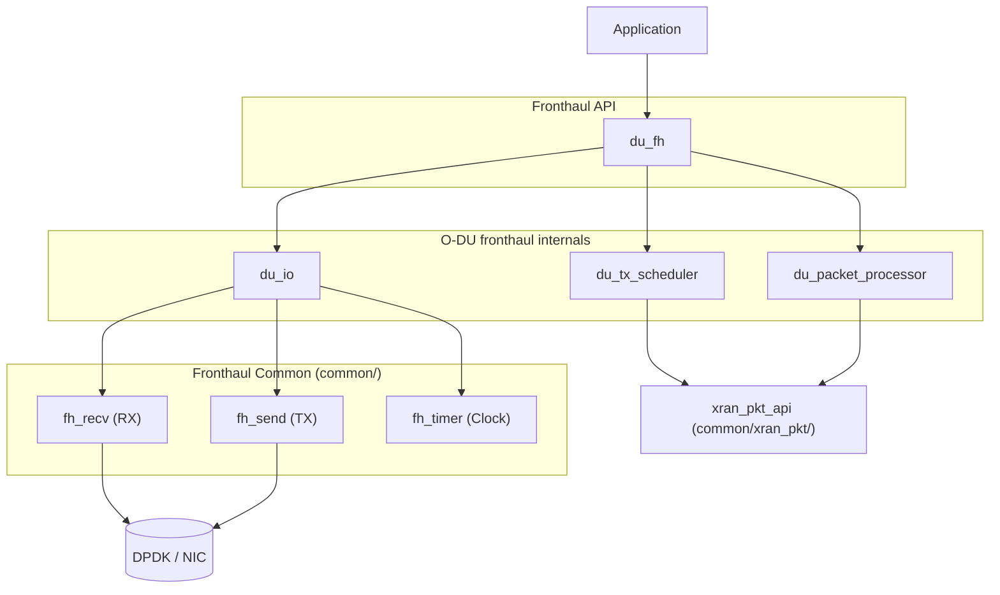

<!-- SPDX-License-Identifier: CC-BY-4.0 -->

# O-DU Fronthaul Library

The O-DU side of the 7.2x split. It is built on the same `fronthaul/common` primitives
(`fh_recv`, `fh_send`, `fh_timer`) and `xran_pkt` packet code as the O-RU library in
`fronthaul/oru`. It supports one carrier with one numerology, in TDD or FDD.

## Components

- `du_io`: DPDK port setup, the RX poll loop and the TX path. It adds the Ethernet header to
  outgoing packets.
- `du_tx_scheduler`: queues DL C-Plane, DL U-Plane and UL C-Plane per symbol, and sends each
  packet when its time comes.
- `du_packet_processor`: collects UL U-Plane and PRACH packets into per-symbol jobs.
- `du_fh`: the public API in `du_fh.h`. It ties the timer to the scheduler and the packet
  processor, and routes received packets.

## Threading

A single worker core (`worker_core`) polls the NIC and runs `fh_timer`. On every symbol tick it
closes the UL receive windows that have expired and transmits the TX packets queued for that
symbol. The application threads that queue TX work build those packets themselves, so the worker
only sends them. Application threads also read completed UL jobs through the API.

The timer also produces one event per OTA slot, DL or UL, once that slot's UL receive window has
closed. `du_fh_wait_slot()` blocks on it, which gives the application a slot clock that matches
the vendor library's per-slot callback. When more than `DU_FH_MAX_SLOT_BACKLOG` events are
pending, it skips to the newest one. After `du_fh_stop()` it returns -1, so a thread blocked in it
can finish.

## Timing

Times are configured in microseconds and converted to whole symbols. The TX clock starts in
`du_fh_init()`, so work can be queued as soon as the handle exists.

| Traffic | Sent or accepted | Window |
|---|---|---|
| DL C-Plane | sent `T1a_cp_dl_max - 1` symbols before OTA | `T1a_cp_dl` |
| DL U-Plane | sent `T1a_up_max - 1` symbols before OTA | `T1a_up` |
| UL C-Plane, PRACH C-Plane | sent `T1a_cp_ul_max - 1` symbols before OTA | `T1a_cp_ul` |
| UL U-Plane, PRACH | accepted `Ta3_min` to `Ta3_max` symbols after OTA | `Ta3` |

Work queued after its send time is dropped and counted (`app_too_late_tx`,
`dl_cplane_too_late`, `ul_grant_too_late`), and so is work queued too far ahead for the send
queues (`too_far_ahead`). One slot after a symbol is sent, its queue is checked again; packets
found there were queued after it was sent, and are dropped and counted (`tx_late`). Packets
received outside `Ta3` are dropped and counted as early or late.

## DL

`du_fh_tx_send_dl_iq()` queues one DL symbol for all antennas. The symbol carries a list of
sections, each a PRB range with its own beam ID. The library sends one C-Plane section type 1
message per antenna, and U-Plane packets split to fit the MTU. U-Plane is BFP compressed when
`comp_type` is set, and the C-Plane `udCompHdr` carries the configured compression. The packets
are built during the call, so the IQ buffers can be reused as soon as it returns.

## UL

`du_fh_schedule_ul_grant()` sends the UL C-Plane for a symbol. `du_fh_expect_ul_symbol()`
tells the packet processor which PRBs to expect for it. A UL job is ready as soon as all
expected PRBs have arrived, or when its `Ta3` window closes; anything still missing is zero.
`du_fh_read_ul_iq()` returns ready jobs in symbol order, and blocks until one is ready.
`du_fh_read_ul_iq_upto()` returns one only if it is at or before a given symbol, and never
blocks.

`du_fh_schedule_prach()` sends the PRACH C-Plane (section type 3) for an occasion, and
`du_fh_expect_prach_occasion()` registers it with the packet processor. The packet processor
adds up the repetitions over the occasion's symbols, and the job is ready when the window of its
last symbol closes. `du_fh_read_prach_iq()` returns the 139 PRACH subcarriers starting at `kbar`,
and blocks until a job is ready. `du_fh_read_prach_iq_upto()` returns one only if its occasion
starts at or before a given symbol, and never blocks.

## Tests

`ctest -L fronthaul` runs the unit tests in `tests/`, and the O-DU to O-RU loopback tests in
`fronthaul/tests/`. Those wire this library's TX scheduler and packet processor to the O-RU
packet processor in one process, and check DL, UL and PRACH IQ with and without BFP
compression (`ctest -L du_oru`).
