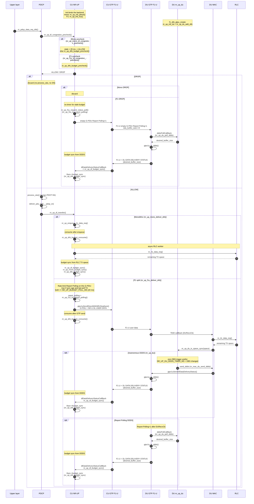

<!-- SPDX-License-Identifier: CC-BY-4.0 -->

# NR user plane (`nr_up`)

[[_TOC_]]

`nr_up` sits between PDCP and the lower user-plane path on gNB and UE. It
decides whether a downlink DRB SDU may proceed (congestion admission), then
delivers the sealed PDCP PDU either to local RLC (mono / UE) or over F1-U GTP
(CU). PDCP talks only to this API.

On the DU, a separate module `nr_up_du` owns DL DATA DELIVERY STATUS (DDDS)
policy for F1-U.

## Why we need this layer ?

Without an early admission check, a DL SDU can be ciphered, given a PDCP SN,
and pushed toward RLC (or F1-U) only to be thrown away when a lower buffer is
full. That wastes crypto and queue work, and it opens a PDCP SN gap at the
receiver.

**TS 38.323** (PDCP) makes that ordering explicit.

Clause 5.2.1 (Transmit operation):

> For a PDCP SDU received from upper layers, the transmitting PDCP entity shall:
>
> - associate the COUNT value [...]
> - perform integrity protection, and ciphering [...]
> - set the PDCP SN of the PDCP Data PDU [...]
> - increment TX_NEXT by one
> - submit the resulting PDCP Data PDU to lower layer [...]

Clause 5.3 (SDU discard):

> If the corresponding PDCP Data PDU has already been submitted to lower layers,
> the discard is indicated to lower layers.
>
> NOTE 2: Discarding a PDCP SDU already associated with a PDCP SN causes a SN
> gap in the transmitted PDCP Data PDUs, which increases PDCP reordering delay
> in the receiving PDCP entity. It is up to UE implementation how to minimize
> SN gap after SDU discard.

So congestion admission belongs before `process_sdu` / SN advance: if the
SDU will not be sent, it must never consume an SN.

**TS 38.322** (RLC) clause 5.4 (SDU discard) ties discard at RLC to a PDCP
indication:

> When indicated from upper layer (i.e. PDCP) to discard a particular RLC SDU,
> the transmitting side of an AM RLC entity or the transmitting UM RLC entity
> shall discard the indicated RLC SDU, if neither the RLC SDU nor a segment
> thereof has been submitted to the lower layers. The transmitting side of an
> AM RLC entity shall not introduce an RLC SN gap when discarding an RLC SDU.

**TS 38.425** (NR user plane) clause 5.1 places flow control at the PDCP host:

> The NR user plane protocol layer is using services of the transport network
> layer in order to allow flow control of user data packets transferred from
> the node hosting PDCP to the corresponding node.

On F1, that is Desired Buffer Size / DDDS on the midhaul. The important part
for OAI is where the stop/send decision lives: at the node that hosts PDCP,
before SN assignment.

That is why both layouts share `nr_up`:

- Monolithic gNB: PDCP and RLC are in one process, but admission still
  happens in `nr_up` using a cached RLC TX budget.
- F1 / CU: the same `nr_up` precheck and budget cache, the F1 backend
  refreshes the cache from DDDS and asks for status with Report Polling.
- F1 / DU: `nr_up_du` answers Report Polling and pushes autonomous DDDS
  (Desired Buffer Size hit/left 0, or DBS changed after
  `NR_UP_DU_DDDS_TIMER_MS`). GTP only carries the PDUs.

PDCP calls nr-up only. The backend is chosen at `nr_up_init_*`:

| Role | PDCP deliver | nr-up init | Backend |
|------|--------------|------------|---------|
| gNB mono | `deliver_pdu_drb` | `nr_up_init_direct` | PDCP DL goes to local RLC (same process) |
| gNB F1 / CU | `deliver_pdu_drb` | `nr_up_init_f1u` | PDCP DL goes over F1-U GTP to the DU |
| gNB F1 / DU | (no PDCP) | `nr_up_init_du` | DDDS policy in `nr_up_du`, GTP TX via callback |
| UE | `deliver_pdu_drb` | `nr_up_init_ue` | PDCP UL goes to local RLC, same precheck as mono |

## DRB downlink

For each DL SDU on the gNB, PDCP asks nr-up whether the backend or local
RLC can take more data before assigning a PDCP SN. If nr-up says DROP,
the SDU is discarded and no SN is consumed. If ALLOW, PDCP builds the PDU
and hands it to the role backend from the table above.

1. `nr_pdcp_data_req_drb`: entry from upper layers
2. `nr_up_dl_congestion_precheck`: ALLOW or DROP
3. `rb->process_sdu`: assign SN and build the PDCP PDU (upon ALLOW only)
4. `deliver_pdu_drb` -> `nr_up_dl_transfer` -> `iface->deliver_drb`:
   mono enqueues to local RLC, F1/CU sends on GTP F1-U

CU congestion uses a shared per-DRB budget cache
(`nr_up_drb_budget_precheck` / `consume` / `sync`). Precheck never calls
RLC live. Insufficient budget drops (DROP) until a later sync.

Mono/UE budget updates from `nr_rlc_data_req` and DU Desired Buffer Size
reports from `nr_rlc_get_available_tx_space` both use the remaining RLC TX
buffer space: `max(0, tx_maxsize - tx_size)`. RLC `recv_sdu` rejects an SDU
if adding it would exceed `tx_maxsize`.

- **Mono** precheck (`nr_up_mono_dl_congestion_precheck`): if last sync is
  older than `NR_UP_MONO_BUDGET_STALE_MS` (20 ms), ALLOW without trusting
  occupancy.
- **F1** precheck (`nr_up_f1u_dl_congestion_precheck`): on DROP, rate-limited
  empty DL USER DATA with Report Polling (`nr_up_f1u_request_status_poll`)
  so DDDS can refresh.
- On F1 deliver, CU sets Report Polling when the cache is missing or sync age
  is at least `NR_UP_BUDGET_POLL_MS` (20 ms) and the last poll TX is at least
  that old (`nr_up_f1u_try_report_polling`). Report Delivered stays off
  (needs feedback on RLC AM in-sequence delivery).

## DU DDDS (`nr_up_du`)

`nr_up_du` owns NR-U DL DATA DELIVERY STATUS policy on the DU: Desired Buffer
Size from RLC TX space, when to answer Report Polling, and when to send
autonomous DDDS. It keeps last-report bookkeeping per ue/drb. GTP keeps
tunnel state (sock / peer / TEID) and carries the PDUs.

`f1_drb_gtpu_create` calls `nr_up_init_du(nr_mac_du_send_ddds)`,
creates the GTP tunnel, then `nr_up_du_add_drb`. The TX callback binds the F1
GTP instance and calls `gtpv1uSendDlDataDeliveryStatus`. The create path also
registers `DURecvCb` and `nr_up_du_poll_ddds`. Poll/sync only look up existing
DRB state. MAC teardown helpers (`nr_mac_du_delete_f1u_tunnel` /
`nr_mac_du_delete_all_f1u_tunnels`) delete the GTP tunnel and call
`nr_up_du_release_drb` / `nr_up_du_release_ue`.

Two paths can send DDDS (see the sequence diagram below):

- Report Polling: on F1-U DL G-PDU RX with Report Polling = 1, GTP calls
  `nr_up_du_poll_ddds`, which reads RLC TX space, records the report, and
  returns Desired Buffer Size. GTP then sends on the RX bearer via
  `gtpv1u_tx_ddds`.
- Autonomous: after `nr_rlc_data_req`, `DURecvCb` calls
  `nr_up_du_tx_space_sync` with remaining TX space. A DDDS is sent when Desired
  Buffer Size hits or leaves 0 (TS 38.425 clause 5.4.2.1), or when DBS changed
  and `NR_UP_DU_DDDS_TIMER_MS` (20 ms) has elapsed. TX uses the function
  pointer from `nr_up_init_du` (`nr_mac_du_send_ddds`, `gtpv1uSendDlDataDeliveryStatus`).

## Downlink DRB procedures (mono and F1)

