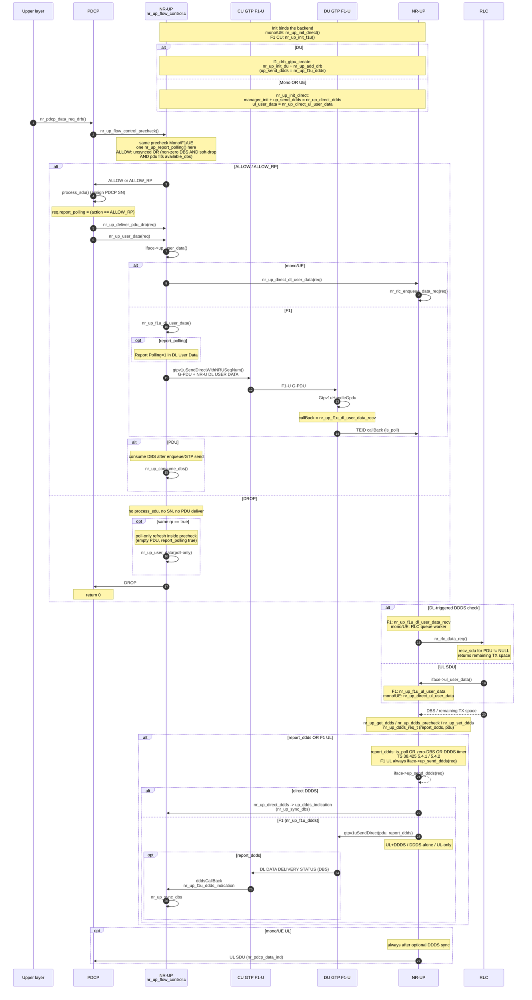

<!-- SPDX-License-Identifier: CC-BY-4.0 -->

# NR user plane (`nr_up`)

[[_TOC_]]

`nr_up` sits between PDCP and the lower user-plane path on gNB and UE. It
decides whether a downlink DRB SDU may proceed (congestion admission), then
delivers the sealed PDCP PDU either to local RLC (mono / UE) or over F1-U GTP
(CU). PDCP talks only to this API.

On the DU, the same manager holds DDDS report state. `nr_up_du` owns F1-U DL
USER DATA RX, UL TX, and DDDS send toward the CU.

## Why we need this layer

Without an early admission check, a DL SDU can be ciphered, given a PDCP SN,
and pushed toward RLC (or F1-U) only to be thrown away when a lower buffer is
full. That wastes crypto and queue work, and it opens a PDCP SN gap at the
receiver.

**TS 38.323** (PDCP) makes that ordering explicit.

Clause 5.2.1 (Transmit operation):

> For a PDCP SDU received from upper layers, the transmitting PDCP entity shall:
>
> - associate the COUNT value [...]
> - perform integrity protection, and ciphering [...]
> - set the PDCP SN of the PDCP Data PDU [...]
> - increment TX_NEXT by one
> - submit the resulting PDCP Data PDU to lower layer [...]

Clause 5.3 (SDU discard):

> If the corresponding PDCP Data PDU has already been submitted to lower layers,
> the discard is indicated to lower layers.
>
> NOTE 2: Discarding a PDCP SDU already associated with a PDCP SN causes a SN
> gap in the transmitted PDCP Data PDUs, which increases PDCP reordering delay
> in the receiving PDCP entity. It is up to UE implementation how to minimize
> SN gap after SDU discard.

So congestion admission belongs before `process_sdu` / SN advance: if the
SDU will not be sent, it must never consume an SN.

**TS 38.322** (RLC) clause 5.4 (SDU discard) ties discard at RLC to a PDCP
indication:

> When indicated from upper layer (i.e. PDCP) to discard a particular RLC SDU,
> the transmitting side of an AM RLC entity or the transmitting UM RLC entity
> shall discard the indicated RLC SDU, if neither the RLC SDU nor a segment
> thereof has been submitted to the lower layers. The transmitting side of an
> AM RLC entity shall not introduce an RLC SN gap when discarding an RLC SDU.

**TS 38.425** (NR user plane) clause 5.1 places flow control at the PDCP host:

> The NR user plane protocol layer is using services of the transport network
> layer in order to allow flow control of user data packets transferred from
> the node hosting PDCP to the corresponding node.

On F1, that is Desired Buffer Size / DDDS on the midhaul. The stop/send
decision lives at the node that hosts PDCP, before SN assignment.

That is why both layouts share `nr_up`:

- Monolithic gNB: PDCP and RLC are in one process, flow control via cached
  RLC TX budget in `nr_up`.
- F1 / CU: the same precheck and budget cache, the F1 backend refreshes the
  cache from DDDS and asks for status with Report Polling.
- F1 / DU: `nr_up_du` answers Report Polling and pushes DDDS (Desired Buffer
  Size hit/left 0, or DBS changed after `NR_UP_DDDS_TIMER_MS`). GTP only
  carries the PDUs.

## Roles and init

PDCP calls nr-up only. The backend is chosen at `nr_up_init_*`:

| Role | PDCP deliver | nr-up init | Backend |
|------|--------------|------------|---------|
| gNB mono | `nr_up_deliver_pdu_drb` | `nr_up_init_direct` | DL to local RLC; UL via `nr_up_direct_ul_user_data` |
| gNB F1 / CU | `nr_up_deliver_pdu_drb` | `nr_up_init_f1u` | DL over F1-U GTP; DDDS RX via `nr_up_f1u_ddds_indication` |
| gNB F1 / DU | (no PDCP) | `nr_up_init_du` | `ul_user_data` = `nr_up_f1u_ul_user_data`; `up_send_ddds` = `nr_up_f1u_ddds` |
| UE | `nr_up_deliver_pdu_drb` | `nr_up_init_direct` | same as mono (local RLC) |

Per-DRB budget entries:

- Insert: `nr_up_add_drb` from `nr_pdcp_add_drb` (mono/UE), CU-UP
  `f1_drb_gtpu_create`, and DU `f1_drb_gtpu_create`.
- Release: `nr_up_release_drb` from PDCP teardown and MAC F1-U tunnel delete.
- Remap: `nr_up_update_ue_id` on F1 reestablishment (rekeys the same object).

## DRB downlink (shared precheck)

For each DL SDU, PDCP asks nr-up before assigning a PDCP SN.

1. `nr_pdcp_data_req_drb`
2. `nr_up_flow_control_precheck`: one `nr_up_report_polling` check ->
   ALLOW, ALLOW_RP, or DROP
3. On ALLOW / ALLOW_RP: `process_sdu`, set `req.report_polling` from
   ALLOW_RP, then `nr_up_deliver_pdu_drb` -> `nr_up_user_data`
4. Backend: mono/UE `nr_up_direct_dl_user_data`, F1/CU `nr_up_f1u_dl_user_data`

Budget cache (`nr_up_dbs_t` per DRB):

- `nr_up_manager_get_dbs` returns a copy under the manager lock.
- Unsynced after setup (`last_dbs_sync == NR_UP_DBS_NEVER_SYNCED`): ALLOW.
- ALLOW when last reported DBS is non-zero, `pdu_max_size` fits in
  `available_dbs`, and remaining budget is still above the soft-drop floor
  (about 20% of last DBS; `NR_UP_SOFT_DROP_THRESHOLD` = 80%).
- `nr_up_report_polling` runs once in precheck (stale / unsynced DBS and
  `NR_UP_REPORT_POLLING_TIMER_MS` = 20 ms): ALLOW_RP sets the flag on the
  real PDU. DROP sends poll-only `nr_up_user_data` (empty PDU).
- After enqueue or GTP send of a real PDU: `nr_up_consume_dbs`.
- Sync from local RLC (mono) or DDDS RX (F1): `nr_up_sync_dbs`.

Report Polling follows TS 38.425 clause 5.5.3.3. Report Delivered stays off
(needs feedback on RLC AM in-sequence delivery).

## DDDS policy (DU and mono UL)

Southbound report state is `nr_up_ddds_t` (`ddds_report` on the per-DRB entry).

Callers:

1. `nr_up_get_ddds`
3. `nr_up_ddds_precheck`: TS 38.425 clause 5.4.2.1: Report Polling, DBS
   hit/leave 0, or DBS changed after timer expiry
4. On send: `nr_up_set_ddds`, then `iface->up_send_ddds`

## Downlink and DDDS (mono and F1)

