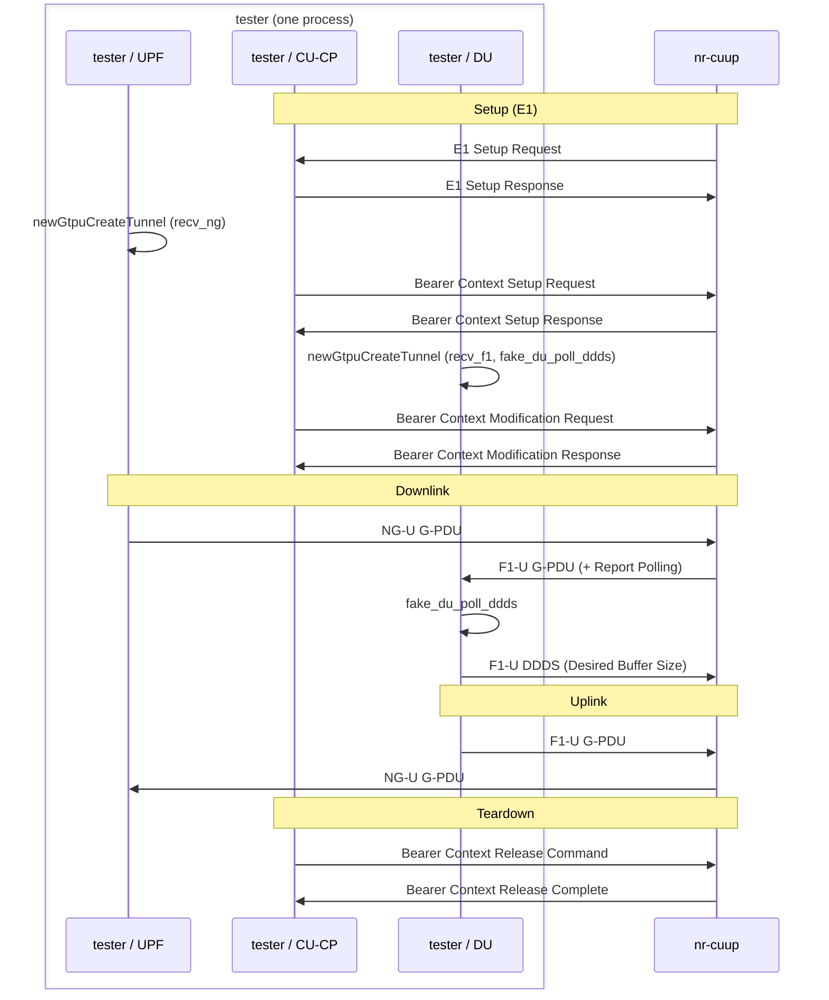

<!-- SPDX-License-Identifier: CC-BY-4.0 -->

This is a simple tester for the CU-UP. It configures the CU-UP via E1, and can
stream data via GTP in uplink and downlink directions.

[[_TOC_]]

# Overview

From a schematic point of view, the tester/CU-UP interaction looks like this:

The tester is for performance testing of a CU-UP, and behaves like an
integrated DU/CU-CP/UPF from the CU-UP's point of view.

The tester and CU-UP have an E1 connection through which control information is
exchanged, e.g., configuration of UEs/bearers and associated information. In
other words, towards the CU-UP, the tester appears like a CU-CP.

Further, for each UE/bearer, CU-UP is configured with GTP IP information and
the corresponding TEID. The CU-UP will forward downlink data arriving on NG-U
on the F1-U interface, and uplink data arriving on F1-U on the NG-U interface.
In other words, on the F1-U interface, the tester appears like a DU to the
CU-UP, and on the NG-U interface, the tester appears like a UPF to the CU-UP.

A test scenario is fixed to these steps:

1. The tester sets up a number of UEs via the E1 interface (it is possible to
   see the message exchange in Wireshark).
2. The tester streams data in downlink/uplink (from the CU-UP's point of view)
   and measures how much data is lost.
3. The tester releases all the UEs via the E1 interface, and disconnects from
   the CU-UP.

Note: The tester uses the same GTP module as the CU-UP. Thus, data might not
only be lost at the GTP interface of the CU-UP, but also at the tester.

# Usage

You can build the CU-UP and the tester like so:

    cd ~/openairinterface5g
    mkdir build && cd build && cmake .. -GNinja && ninja nr-cuup nr-cuup-load-test params_libconfig
    ./tests/nr-cuup/nr-cuup-load-test
    ./nr-cuup -O ../tests/nr-cuup/load-test.conf

This builds both tester and CU-UP in the directory `build/`, then starts the
load tester with default values

- 1 UE
- 10s of Test
- 60 Mbps of traffic in both downlik/uplink with a packet size of 1400 bytes

To see the available options, run

    ./tests/nr-cuup/nr-cuup-load-test -h

The configuration file [`load-test.conf`](./load-test.conf) matches the default
tester configuration (F1-U GTP traffic over non-standard port 2153, NG-U GTP
over 2152, tests on localhost). The configuration file includes this
non-standard port 2153 as the GTP module, as of now, cannot bind on the same
interface and port for both F1-U and NG-U due to internal limitations.

# Limitations

- The tester does not yet create/remove UEs during a traffic test.
- It might be possible to integrate with an external GTP traffic generator,
  but we did not test this.
